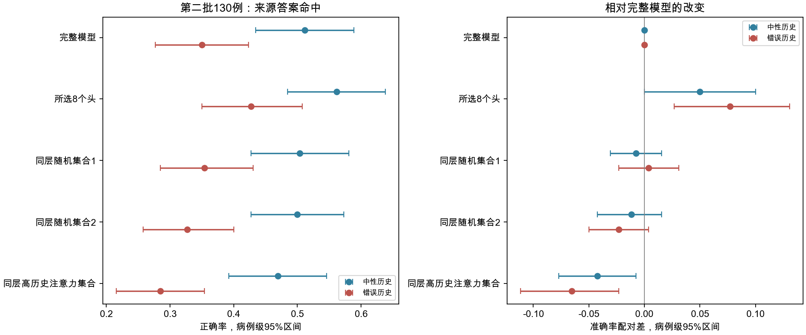

# 所选注意力头是否有可复现的作用

## 本阶段结论

所选8头干预的代码选择改善在独立130例复现，并优于两个同层随机集合及一个同层高历史注意力集合；三个错误历史比较经Holm校正均小于0.01。高历史注意力集合关闭后反而降低正确率，说明注意力大小不足以选出应当减弱的部件。

同一所选8头关闭后，正确旧诊断正对照的命中率降低6.15个百分点，95%CI [−11.15, −1.15]。结果支持它们参与旧诊断利用的解释，作用有益还是有害取决于历史内容。

代码收益没有转化为完整候选生成收益：错误历史下原模型54/130，首步和持续干预均48/130；持续干预没有修复差异。在同病例配对比较中，代码干预收益减去名称生成收益为12.31个百分点，[5.38, 20.00]。因此本组头的作用依赖作答接口，不能称为已完成的通用诊断改进。[历史方向与生成的配对比较](INTERFACE_AND_HISTORY.md)。

由首批345例中8头干预的改善触发，随后在未参与结构选择或首批结构检验的130例上冻结复核：MedQA82、MedMCQA48。此批不包含MMLU。三个对照与所选头保持相同层位置及每层头数，分别是两个固定随机集合和同层高历史注意力集合；均排除原所选头。

| 结构 | 历史 | 正确率，95%CI | 相对完整模型变化，95%CI | 原诊断一致率 |
|---|---|---|---|---|
| 完整模型 | neutral | 51.15% [43.46, 58.85] | 0.00% [0.00, 0.00] | 100.00% [97.20, 100.00] |
| 完整模型 | wrong | 35.00% [27.69, 42.32] | 0.00% [0.00, 0.00] | 100.00% [97.20, 100.00] |
| 所选8个头 | neutral | 56.15% [48.46, 63.85] | 5.00% [0.00, 10.00] | 80.77% [75.38, 85.77] |
| 所选8个头 | wrong | 42.69% [35.00, 50.77] | 7.69% [2.69, 13.08] | 79.62% [73.85, 85.38] |
| 同层随机集合1 | neutral | 50.38% [42.69, 58.08] | -0.77% [-3.08, 1.54] | 94.23% [90.77, 97.31] |
| 同层随机集合1 | wrong | 35.38% [28.46, 43.08] | 0.38% [-2.31, 3.08] | 94.23% [91.15, 96.92] |
| 同层随机集合2 | neutral | 50.00% [42.69, 57.31] | -1.15% [-4.23, 1.54] | 91.15% [87.69, 94.23] |
| 同层随机集合2 | wrong | 32.69% [25.77, 40.00] | -2.31% [-5.00, 0.38] | 93.08% [89.62, 96.15] |
| 同层高历史注意力集合 | neutral | 46.92% [39.23, 54.62] | -4.23% [-7.69, -0.77] | 85.77% [81.15, 90.38] |
| 同层高历史注意力集合 | wrong | 28.46% [21.54, 35.38] | -6.54% [-11.15, -2.31] | 82.69% [78.08, 87.31] |

## 所选头与同层对照直接比较

| 对照 | 历史 | 所选头减去对照的准确率差 | 错误历史三比较Holm校正p |
|---|---|---|---|
| 同层随机集合1 | neutral | 5.77% [1.15, 10.38] | — |
| 同层随机集合1 | wrong | 7.31% [2.31, 12.69] | 0.008998875140607425 |
| 同层随机集合2 | neutral | 6.15% [0.77, 11.15] | — |
| 同层随机集合2 | wrong | 10.00% [5.00, 15.38] | 0.0007499062617172854 |
| 同层高历史注意力集合 | neutral | 9.23% [3.46, 15.00] | — |
| 同层高历史注意力集合 | wrong | 14.23% [8.07, 21.15] | 0.00037495313085864263 |

差值按百分点解释。p来自病例级配对符号置换（8000次），仅对预定三个错误历史比较做Holm校正；所有估计同时提供区间。

## 同一批头遇到正确旧诊断

本表明确把来源答案写入历史，是oracle正对照，不能当作正常诊断性能。

| 结构 | 命中来源答案，95%CI | 相对完整模型变化，95%CI |
|---|---|---|
| 完整模型 | 81.92% [75.76, 87.69] | 0.00% [0.00, 0.00] |
| 所选8个头 | 75.77% [68.85, 82.31] | -6.15% [-11.15, -1.15] |

干预在错误历史下的准确率作用，减去在正确历史下的作用：13.85% [7.69, 20.38]（百分点）。

## 实际生成完整候选

| 结构 | 历史 | 答对/130 | 相对完整模型变化，95%CI |
|---|---|---:|---|
| 完整模型 | neutral | 70 | 0.00% [0.00, 0.00] |
| 完整模型 | wrong | 54 | 0.00% [0.00, 0.00] |
| 所选8头：只改输入末位置 | neutral | 66 | -3.08% [-9.23, 3.08] |
| 所选8头：只改输入末位置 | wrong | 48 | -4.62% [-10.00, 0.77] |
| 所选8头：持续到全部生成词元 | neutral | 65 | -3.85% [-10.00, 2.31] |
| 所选8头：持续到全部生成词元 | wrong | 48 | -4.62% [-10.00, 0.77] |

代码实验及首步生成只作用于最后输入位置；全生成版本在之后每个生成词元上也持续门控同一8头。两者预填充经过一致性检验，并用空门控检查缓存解码与原生实现相同。所有版本都保留模型参数，不报告头压缩或加速。[冻结追加方案](../../research_v5_structural/FOLLOWUP_HEAD_CONTROLS.md) · [全部统计](summary.json) · [逐病例代码输出](patient_code_results.csv) · [逐病例实际生成](patient_generation_results.csv)
