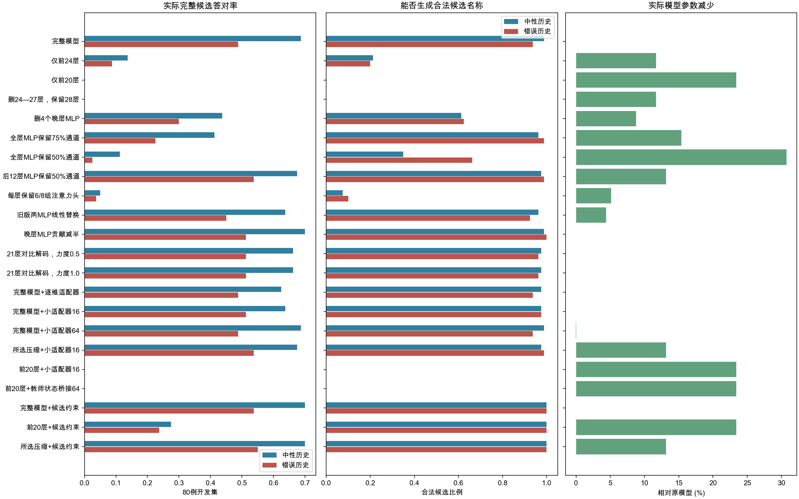

# 结构与适配器：全部开发尝试

80例开发集，MedQA/MedMCQA各40例；每例中性与错误历史，直接生成完整候选。下表用于选方案，不当作最终确认性能。全部22个配置保留，包括无法输出合法名称的失败配置。

| 方法 | 参数减少 | 中性答对/80 | 错误历史答对/80 | 中性合法/80 | 错误历史合法/80 |
|---|---:|---:|---:|---:|---:|
| 完整模型 | 0.00% | 55 | 39 | 79 | 75 |
| 仅前24层 | 11.70% | 11 | 7 | 17 | 16 |
| 仅前20层 | 23.40% | 0 | 0 | 0 | 0 |
| 删24—27层，保留28层 | 11.70% | 0 | 0 | 0 | 0 |
| 删4个晚层MLP | 8.78% | 35 | 24 | 49 | 50 |
| 全层MLP保留75%通道 | 15.36% | 33 | 18 | 77 | 79 |
| 全层MLP保留50%通道 | 30.72% | 9 | 2 | 28 | 53 |
| 后12层MLP保留50%通道 | 13.16% | 54 | 43 | 78 | 79 |
| 每层保留6/8组注意力头 | 5.12% | 4 | 3 | 6 | 8 |
| 旧版两MLP线性替换 | 4.38% | 51 | 36 | 77 | 74 |
| 晚层MLP贡献减半 | 0.00% | 56 | 41 | 79 | 80 |
| 21层对比解码，力度0.5 | 0.00% | 53 | 41 | 78 | 77 |
| 21层对比解码，力度1.0 | 0.00% | 53 | 41 | 78 | 77 |
| 完整模型+逐维适配器 | -0.00% | 50 | 39 | 78 | 75 |
| 完整模型+小适配器16 | -0.00% | 51 | 41 | 78 | 78 |
| 完整模型+小适配器64 | -0.02% | 55 | 39 | 79 | 75 |
| 所选压缩+小适配器16 | 13.16% | 54 | 43 | 78 | 79 |
| 前20层+小适配器16 | 23.40% | 0 | 0 | 0 | 0 |
| 前20层+教师状态桥接64 | 23.39% | 0 | 0 | 0 | 0 |
| 完整模型+候选约束 | 0.00% | 56 | 43 | 80 | 80 |
| 前20层+候选约束 | 23.40% | 22 | 19 | 80 | 80 |
| 所选压缩+候选约束 | 13.16% | 56 | 44 | 80 | 80 |

最终主候选按开发表现冻结为：**所选压缩+候选约束**。确认集固定方法、代码散列和全部选择记录见[冻结清单](../../runs/structural_v2/confirmation_selection.json)。

削减整层、削减通道、加输出适配器、约束解码是不同操作；候选约束会直接保证格式，不把它的合法率改善当作模型已学会医学知识。所有指标都与生成的原文一起保存。

后续源文本复核标记了5例开发病例；本表保留最初80例的实际选型记录，没有在确认运行后重选。来源质量敏感性见[审计](../../research_v6_adapters/SOURCE_AUDIT.md)。

## 结果后统一写法的敏感性

上表和方案选择使用原逐字评分。下表对22配置同样清理表面写法，要求唯一匹配原候选；不据此重选方案。[规则](../../research_v6_adapters/SCORING_AUDIT.md)。

| 方法 | 规范化中性命中/80 | 规范化错误历史命中/80 |
|---|---:|---:|
| 完整模型 | 55 | 42 |
| 仅前24层 | 17 | 16 |
| 仅前20层 | 0 | 0 |
| 删24—27层，保留28层 | 2 | 1 |
| 删4个晚层MLP | 35 | 25 |
| 全层MLP保留75%通道 | 35 | 19 |
| 全层MLP保留50%通道 | 24 | 10 |
| 后12层MLP保留50%通道 | 55 | 44 |
| 每层保留6/8组注意力头 | 5 | 4 |
| 旧版两MLP线性替换 | 52 | 39 |
| 晚层MLP贡献减半 | 56 | 41 |
| 21层对比解码，力度0.5 | 54 | 42 |
| 21层对比解码，力度1.0 | 54 | 42 |
| 完整模型+逐维适配器 | 51 | 43 |
| 完整模型+小适配器16 | 51 | 41 |
| 完整模型+小适配器64 | 55 | 42 |
| 所选压缩+小适配器16 | 55 | 44 |
| 前20层+小适配器16 | 0 | 0 |
| 前20层+教师状态桥接64 | 0 | 0 |
| 完整模型+候选约束 | 56 | 43 |
| 前20层+候选约束 | 22 | 19 |
| 所选压缩+候选约束 | 56 | 44 |
