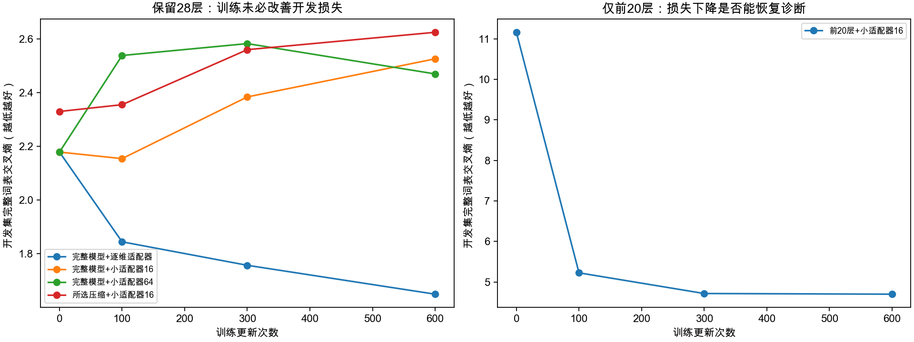

# 小适配器与尾部桥接训练

400例训练，80例开发选择检查点；未使用400例确认病例。冻结原模型，只训练小模块；所有原模型文件保持不变。完整词表151936维交叉熵，真实来源候选及JSON结束符/EOS作为目标。每个序列总权重相同，首个候选词元占一半，后续词元共享另一半。

| 方法 | 训练参数 | 所选更新步 | 初始开发损失 | 最佳开发损失 |
|---|---:|---:|---:|---:|
| 完整模型+逐维适配器 | 4,096 | 600 | 2.178 | 1.649 |
| 完整模型+小适配器16 | 67,600 | 100 | 2.178 | 2.154 |
| 完整模型+小适配器64 | 264,256 | 0 | 2.178 | 2.178 |
| 所选压缩+小适配器16 | 67,600 | 0 | 2.329 | 2.329 |
| 前20层+小适配器16 | 67,600 | 600 | 11.161 | 4.699 |

**没有得到有效训练收益、最终退回零初始化的配置：完整模型+小适配器64、所选压缩+小适配器16。** 这些名称虽然含“适配器”，实际所选小模块的输出改变量为零；不能将它们与原骨干的相同结果称为适配器修复成功。

秩64桥接用266,240个参数替代8个尾层，拟合第20层到第28层的教师状态。开发加权MSE由直接使用第20层的8.5882降至2.2811；状态接近不自动等于诊断正确，需看实际生成。

适配器直接学习来源答案，因此其改善可能包含新增的医学对应关系。不能将所有修复解释为原模型本来就会。桥接不采用额外疾病分类损失，但教师强制前缀仍使用来源答案。

后续源文本复核标记训练9例、开发5例；本轮保留原训练和选型，不把它们称为重新清洁后训练的模型。[来源复核](../../research_v6_adapters/SOURCE_AUDIT.md)。
