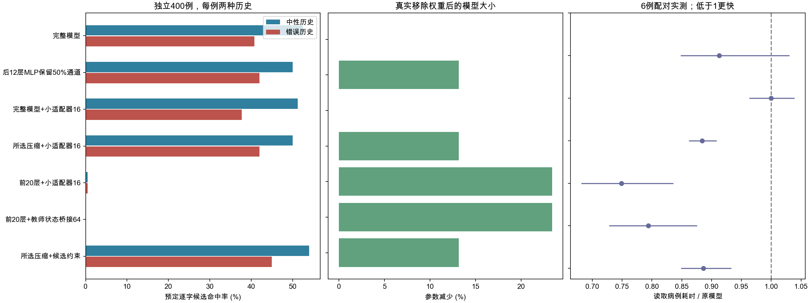
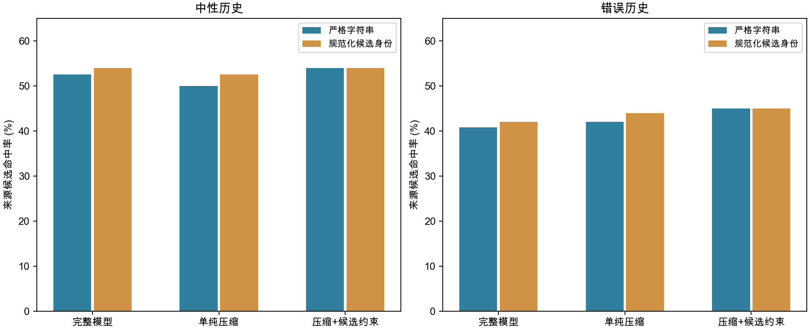
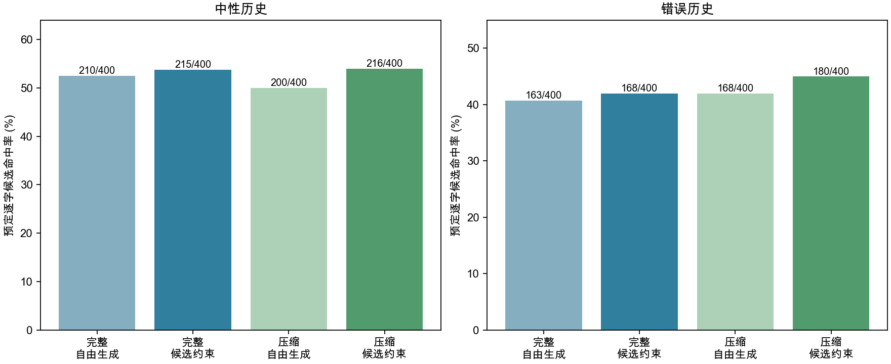
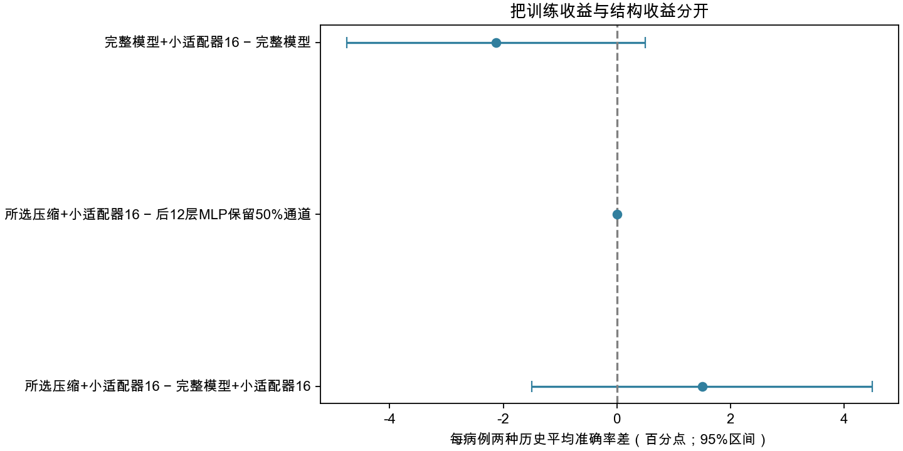

# 独立400例：结构、训练和输出分别解决什么

MedQA与MedMCQA各200例。确认前冻结7种方法；每例分别加入中性历史和错误历史，实际生成完整候选名称。主指标先在每病例内平均两种历史，再跨病例统计。适配器只见过另400例训练，80例开发选择检查点。

下表保留原预定逐字评分；解释疾病选择时请同时看后面的规范化评分。

| 方法 | 中性答对/400 | 错误历史答对/400 | 参数减少 | 读取病例耗时比 |
|---|---:|---:|---:|---:|
| 完整模型 | 210 | 163 | 0.00% | 1.00（参照） |
| 后12层MLP保留50%通道 | 200 | 168 | 13.16% | 0.91 [0.85, 1.03] |
| 完整模型+小适配器16 | 205 | 151 | -0.00% | 1.00 [0.96, 1.04] |
| 所选压缩+小适配器16 | 200 | 168 | 13.16% | 0.88 [0.86, 0.91] |
| 前20层+小适配器16 | 2 | 2 | 23.40% | 0.75 [0.68, 0.84] |
| 前20层+教师状态桥接64 | 0 | 0 | 23.39% | 0.79 [0.73, 0.88] |
| 所选压缩+候选约束 | 216 | 180 | 13.16% | 0.89 [0.85, 0.93] |

## 评分核查：严格字符串命中不能直接等同于医学判断改善

原预定评分要求完整候选逐字匹配。人工查看原输出发现末尾空格、开头冠词、大小写和引号/括号位置造成丢分。因此对所有方法一致增加确定性写法规范化：保留疾病用词和数字及+-−/<>=%符号，清理表面格式，并要求唯一匹配四个原候选之一；不做同义词或模糊医学匹配，也不据真值决定怎么解析。该分析在主结果之后提出，方法选择保持冻结。[规则与登记](../../research_v6_adapters/SCORING_AUDIT.md)。

规范化后主方案减原模型为**+1.50个百分点，95%区间[+0.00, +3.00]，敏感性六项内Holm p=0.2585**。候选约束修复的28个条件中，18个原回答在该规则下已经匹配正确候选。严格命中率的收益不能全部算作新的疾病判断。

| 方法 | 规范化中性命中/400 | 规范化错误历史命中/400 | 严格366子集中性/错误历史 |
|---|---:|---:|---:|
| 完整模型 | 216 | 168 | 199/155 |
| 后12层MLP保留50%通道 | 210 | 176 | 194/163 |
| 完整模型+小适配器16 | 208 | 155 | 189/145 |
| 所选压缩+小适配器16 | 210 | 176 | 194/163 |
| 前20层+小适配器16 | 2 | 2 | 2/2 |
| 前20层+教师状态桥接64 | 0 | 0 | 0/0 |
| 所选压缩+候选约束 | 216 | 180 | 200/167 |
| 完整模型+候选约束 | 215 | 168 | 198/155 |

来源题干出现“诊断”不保证所有选项都是疾病名；检查特征、分子机制和组合答案等9项另行标记。在366例上再排除这些已标记项目后保留360例。它是附加来源答案类型敏感性，不是完整医学本体审核。[范围说明](../../research_v6_adapters/ANSWER_SCOPE.md)。

| 方法 | 来源类型敏感性中性/错误历史命中 | 相对原模型平均差（百分点，95%区间） |
|---|---:|---:|
| 完整模型 | 197/155 | +0.00 [+0.00, +0.00] |
| 后12层MLP保留50%通道 | 192/163 | +0.42 [-1.67, +2.36] |
| 完整模型+小适配器16 | 188/144 | -2.78 [-5.69, +0.00] |
| 所选压缩+小适配器16 | 192/163 | +0.42 [-1.67, +2.36] |
| 前20层+小适配器16 | 2/2 | -48.33 [-52.64, -43.89] |
| 前20层+教师状态桥接64 | 0/0 | -48.89 [-53.19, -44.44] |
| 所选压缩+候选约束 | 198/167 | +1.81 [+0.28, +3.47] |
| 完整模型+候选约束 | 196/155 | -0.14 [-0.42, +0.00] |

规范化仅修复可机械判断的写法，余下差异仍可能包含错拼或医学同义词，因此它也不是医生级语义判定。[全部修复原文](output_constraint_repairs.csv)和[逐病例双评分](normalized_scores.csv)可核对。

开发集预先选定的主候选：**所选压缩+候选约束**；压缩候选：**所选压缩+候选约束**。不按确认结果重新挑最好者。

## 原逐字评分：相对完整模型的六项预定比较

| 方法 | 平均准确率差及95%区间（百分点） | Holm校正p |
|---|---:|---:|
| 后12层MLP保留50%通道 | -0.62 [-2.75, 1.50] | 1 |
| 完整模型+小适配器16 | -2.12 [-4.75, 0.50] | 0.4342 |
| 所选压缩+小适配器16 | -0.62 [-2.75, 1.50] | 1 |
| 前20层+小适配器16 | -46.12 [-50.25, -41.88] | 0.0007499 |
| 前20层+教师状态桥接64 | -46.62 [-50.88, -42.38] | 0.0007499 |
| 所选压缩+候选约束 | 2.88 [1.12, 4.75] | 0.005999 |

## 补充的匹配输出对照：原逐字评分的2×2比较

看到预定主结果后，追加开发阶段已有的完整模型候选约束配置，在同400例上解释结构与解码的贡献；没有重新选主方法或调参数。这是明确标记的事后解释性对照，未混入原六项确认检验。[追加登记](../../research_v6_adapters/MATCHED_OUTPUT_CONTROL.json)。

| 对比 | 每病例平均准确率差（百分点，95%区间） |
|---|---:|
| 裁剪效应：自由生成 | -0.62 [-2.75, +1.50] |
| 输出约束效应：完整模型 | +1.25 [+0.50, +2.25] |
| 输出约束效应：压缩模型 | +3.50 [+2.00, +5.25] |
| 裁剪效应：相同输出约束 | +1.62 [+0.12, +3.13] |
| 交互：压缩后约束收益增加多少 | +2.25 [+0.88, +3.88] |

同样输出约束下，严格366例的压缩减完整准确率差为+1.91个百分点，95%区间[+0.41, +3.55]。完整约束模型在该子集中性/错误历史答对198/155例。

两模型使用相同候选约束后的直接配对耗时：

- prefill_seconds：压缩/完整=0.95 [0.72, 1.23]。
- fixed12_decode_seconds：压缩/完整=0.92 [0.83, 1.05]。
- actual_answer_seconds：压缩/完整=0.85 [0.81, 0.89]。

## 原逐字评分：训练是否足够，压缩是否另外有益

| 公平比较 | 平均准确率差及95%区间（百分点） | 三项内Holm校正p |
|---|---:|---:|
| 完整模型+小适配器16 − 完整模型 | -2.12 [-4.75, 0.50] | 0.4342 |
| 所选压缩+小适配器16 − 后12层MLP保留50%通道 | 0.00 [0.00, 0.00] | 1 |
| 所选压缩+小适配器16 − 完整模型+小适配器16 | 1.50 [-1.50, 4.50] | 0.7332 |

**适配器失败说明：所选压缩+小适配器16在开发集未获训练收益，最终选择第0步零初始化。** 因而其确认表现反映骨干本身，不能宣称小模块修复了它。

第一行衡量只加适配器能否改善；第二行衡量适配器能否修复压缩；第三行才直接检验“相同训练时，压缩结构是否更好”。未显著变差不等于已证明非劣，本轮没有设非劣界值。

## 仅改变输入

- 去掉历史后答对205/400；相对neutral，修复19例、损坏24例，净差-1.25个百分点。
- 去掉历史后答对205/400；相对wrong，修复75例、损坏33例，净差10.50个百分点。

## 同一结构，只增加输出约束

这项描述性配对把结构和输出约束拆开。非法名称包含无法解析JSON和输出了候选表外名称，不全部归因于单纯格式。

| 约束方法与相同骨干 | 历史 | 非法名称→正确 | 合法错误→正确 | 原本正确→错误 | 原本合法时换病名 |
|---|---|---:|---:|---:|---:|
| 所选压缩+候选约束 / 后12层MLP保留50%通道 | neutral | 15 | 1 | 0 | 1 |
| 所选压缩+候选约束 / 后12层MLP保留50%通道 | wrong | 11 | 1 | 0 | 2 |

这些修复共28个病例—历史条件，其中0个原回答的开头已写出完整来源答案，但原始完整输出未被计为正确的规范候选。该计数只做字面前缀核对，不替代医学同义词审核。[全部修复前原文](output_constraint_repairs.csv)。

## 原逐字错误的可恢复性（含表面格式）

| 历史 | 原模型错误 | 去历史可修复 | 任一未训练方法可修复 | 任一冻结方法可修复 | 加上去历史后任一方法可修复 |
|---|---:|---:|---:|---:|---:|
| neutral | 190 | 19 | 15 | 34 | 44 |
| wrong | 237 | 75 | 20 | 31 | 89 |

错误历史下进一步区分“写出了错误候选”和“未写出合法候选”：

| 方法 | 合法错误→正确 | 非法名称→正确 | 原本正确→错误 | 仍选择预设错误旧病名/400 |
|---|---:|---:|---:|---:|
| 完整模型 | 0 | 0 | 0 | 154 |
| 后12层MLP保留50%通道 | 14 | 1 | 10 | 133 |
| 完整模型+小适配器16 | 17 | 1 | 30 | 156 |
| 所选压缩+小适配器16 | 14 | 1 | 10 | 133 |
| 前20层+小适配器16 | 0 | 0 | 161 | 0 |
| 前20层+教师状态桥接64 | 0 | 0 | 163 | 1 |
| 所选压缩+候选约束 | 15 | 5 | 3 | 139 |

“任一方法修复”需要知道正确答案后挑方法，是错误可恢复性分析，**不是可部署准确率**；各列可能重叠。未训练变换可恢复说明原模型在某些输入/计算路径下有答对能力；训练适配器的改善可能包含新学习；全部方法都未修复不能证明模型完全不懂该疾病。

## 时间、输出长度与数据

耗时为同机GPU同步、原模型/变体交替的配对测量：6例×2种历史×2次重复。区间按6个病例聚合后重采样，反映本机小样本时延，不外推到其他硬件。固定12词元解码比较相同计算长度；实际答案耗时另含不同回答长度和候选约束开销。

| 方法 | 固定12词元耗时比 | 实际回答耗时比 | 原/改平均输出词元 |
|---|---:|---:|---:|
| 后12层MLP保留50%通道 | 0.84 [0.79, 0.90] | 0.86 [0.80, 0.92] | 5.3/5.3 |
| 完整模型+小适配器16 | 1.01 [0.98, 1.03] | 1.03 [1.01, 1.04] | 5.3/5.5 |
| 所选压缩+小适配器16 | 0.89 [0.84, 0.96] | 0.88 [0.86, 0.92] | 5.3/5.3 |
| 前20层+小适配器16 | 0.77 [0.74, 0.82] | 2.16 [1.54, 3.07] | 5.3/37.0 |
| 前20层+教师状态桥接64 | 0.71 [0.69, 0.74] | 0.85 [0.72, 1.06] | 5.3/6.6 |
| 所选压缩+候选约束 | 0.87 [0.86, 0.89] | 0.86 [0.85, 0.86] | 5.3/5.3 |

## 来源质量与近重复敏感性

初始筛选漏掉了部分缺图引用及题干尾语；运行中发现后进行只读源文本复核，未据模型对错选病例。训练仍为原400例、开发选型仍为原80例，没有重新挑最优模型。[完整审计及分词修正](../../research_v6_adapters/SOURCE_AUDIT.md)。下表第一组仅排除源文本问题，第二组再排除与训练/开发/旧540例及确认集内部的0.80近重复；这是事后敏感性，不替代原定400例结果。

| 严格子集 | 方法 | 病例数 | 中性答对 | 错误历史答对 | 相对完整模型的平均差（百分点，95%区间） |
|---|---|---:|---:|---:|---:|
| 文本 | 完整模型 | 386 | 203 | 159 | 0.00 [0.00, 0.00] |
| 文本 | 后12层MLP保留50%通道 | 386 | 194 | 165 | -0.39 [-2.59, 1.68] |
| 文本 | 完整模型+小适配器16 | 386 | 199 | 148 | -1.94 [-4.66, 0.78] |
| 文本 | 所选压缩+小适配器16 | 386 | 194 | 165 | -0.39 [-2.59, 1.68] |
| 文本 | 前20层+小适配器16 | 386 | 2 | 2 | -46.37 [-50.65, -42.10] |
| 文本 | 前20层+教师状态桥接64 | 386 | 0 | 0 | -46.89 [-51.17, -42.62] |
| 文本 | 所选压缩+候选约束 | 386 | 209 | 177 | 3.11 [1.30, 4.92] |
| 文本+近重复 | 完整模型 | 366 | 194 | 150 | 0.00 [0.00, 0.00] |
| 文本+近重复 | 后12层MLP保留50%通道 | 366 | 185 | 155 | -0.55 [-2.73, 1.50] |
| 文本+近重复 | 完整模型+小适配器16 | 366 | 187 | 141 | -2.19 [-4.92, 0.55] |
| 文本+近重复 | 所选压缩+小适配器16 | 366 | 185 | 155 | -0.55 [-2.73, 1.50] |
| 文本+近重复 | 前20层+小适配器16 | 366 | 2 | 2 | -46.45 [-50.96, -42.08] |
| 文本+近重复 | 前20层+教师状态桥接64 | 366 | 0 | 0 | -46.99 [-51.37, -42.62] |
| 文本+近重复 | 所选压缩+候选约束 | 366 | 200 | 167 | 3.14 [1.37, 4.92] |

来源分层与逐病例结果：[CSV](accuracy_by_source.csv)、[全部生成指标](per_case.csv)、[完整统计](summary.json)。参数数量来自实际模型权重树。来源答案是考试题的最终标准答案；本轮不声称临床诊断性能，也不把每个中间前缀当作已有唯一正确诊断。模型API费用为0美元。
