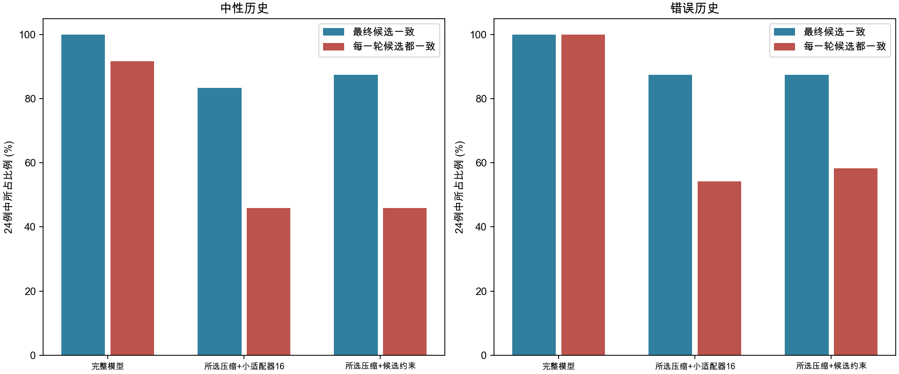

# 压缩以后，医学判断是怎样一路走过去的

24例在看到确认结果前按散列选择，MedQA/MedMCQA各12例；逐句累计证据，每轮重新前向传播。比较完整模型、压缩适配器及预定主候选（若重合则补完整适配器），每例两种历史。所有例子都展示，未只保留改善案例。下表与诊断色块使用写法规范化后的候选身份，原逐字指标也保留在CSV。

| 方法 | 历史 | 最终答对/24 | 最终同原模型/24 | 全程同原模型/24 | 最终相同但此前不同/24 |
|---|---|---:|---:|---:|---:|
| 完整模型 | neutral | 10 | 24 | 22 | 0 |
| 完整模型 | wrong | 7 | 24 | 24 | 0 |
| 所选压缩+小适配器16 | neutral | 11 | 20 | 11 | 8 |
| 所选压缩+小适配器16 | wrong | 8 | 21 | 13 | 7 |
| 所选压缩+候选约束 | neutral | 11 | 21 | 11 | 9 |
| 所选压缩+候选约束 | wrong | 8 | 21 | 14 | 7 |

来源文本与近重复严格子集保留22例；其最终一致/全程一致/最终同而中途异分别如下：

- 完整模型，neutral：22/20/0（分母22）。
- 完整模型，wrong：22/22/0（分母22）。
- 所选压缩+小适配器16，neutral：19/11/7（分母22）。
- 所选压缩+小适配器16，wrong：20/13/6（分母22）。
- 所选压缩+候选约束，neutral：20/11/8（分母22）。
- 所选压缩+候选约束，wrong：20/14/6（分母22）。

## 相同前缀状态，输出规则是否仍能改变答案

比较压缩骨干的零增量适配器与同骨干候选约束：294个前缀条件中，全部层状态最大绝对差为0，输出归一化前后向量最大差为0；原始名称有18个条件不同，规范化候选身份有18个条件不同，其中17个由无法匹配变为合法候选，1个在两个合法候选之间改变。这仅比较读完当前证据、开始续写前的状态；后续生成路径可能不同。候选分数的归一化规则也随约束变化，不能把所有分数变化解释为医学信念的内部更新。[逐前缀核对](output_rule_state_equivalence.csv)。

## 完整候选评分与实际生成

| 方法 | 历史 | 序列评分排对/24 | 长度归一评分排对/24 | 实际答对/24 | 两评分都排对但实际答错/24 |
|---|---|---:|---:|---:|---:|
| 完整模型 | neutral | 10 | 11 | 10 | 0 |
| 完整模型 | wrong | 7 | 7 | 7 | 0 |
| 所选压缩+小适配器16 | neutral | 11 | 11 | 11 | 0 |
| 所选压缩+小适配器16 | wrong | 8 | 8 | 8 | 0 |
| 所选压缩+候选约束 | neutral | 11 | 11 | 11 | 0 |
| 所选压缩+候选约束 | wrong | 8 | 8 | 8 | 0 |

这些是完整模型对候选续写的评分，不是一个独立训练的内部疾病探针；长度归一化是一项敏感性检查。两种评分和真实生成都报告，避免只选择最有利的读数。

两个无效回答不算“一致”，也不直接算“疾病判断不同”；“最终相同但此前不同”必须至少有一轮两个可识别候选实际不同。所以全程一致与最终同但中途异不一定加起来等于最终一致，缺失的部分含无法匹配的轮次。中间改变不自动等于变差：它可能纠正错误，也可能偏离最终来源答案。图中的内部状态是每层输出位置的残差向量；没有在此把距离变化解释为单个疾病神经元。这一24例图谱含一个ASCA检查特征选项，已在[答案范围审计](../../research_v6_adapters/ANSWER_SCOPE.md)单列；图谱展示来源候选，不把所有候选命名为疾病。适配器位于最后输出映射之前，参数在一次推断中固定，随证据改变的是激活与输出分布。

## 全部24例

| 来源 | 病例 | 最终来源答案 | 证据轮次 |
|---|---|---|---:|
| MedQA | [medqa_train_02981](cases/medqa_train_02981.md) | Acid maltase deficiency | 10 |
| MedQA | [medqa_train_06772](cases/medqa_train_06772.md) | Amyotrophic lateral sclerosis | 6 |
| MedQA | [medqa_train_01035](cases/medqa_train_01035.md) | Major depressive disorder | 15 |
| MedQA | [medqa_train_04812](cases/medqa_train_04812.md) | Vascular dementia | 11 |
| MedQA | [medqa_train_09305](cases/medqa_train_09305.md) | Diffuse cutaneous systemic scleroderma | 11 |
| MedQA | [medqa_train_06162](cases/medqa_train_06162.md) | Osteomyelitis | 5 |
| MedQA | [medqa_train_03083](cases/medqa_train_03083.md) | Myotonic dystrophy | 10 |
| MedQA | [medqa_train_02377](cases/medqa_train_02377.md) | Attention-deficit/hyperactivity disorder | 10 |
| MedQA | [medqa_train_06203](cases/medqa_train_06203.md) | Uterine adenomyosis | 4 |
| MedQA | [medqa_train_01997](cases/medqa_train_01997.md) | Gastroschisis | 5 |
| MedQA | [medqa_train_06443](cases/medqa_train_06443.md) | Congenital rubella infection | 13 |
| MedQA | [medqa_dev_00157](cases/medqa_dev_00157.md) | ASCA positivity | 12 |
| MedMCQA | [medmcqa_train_3c860ea8-ae63-4bad-9032-90a0c570bb2c](cases/medmcqa_train_3c860ea8-ae63-4bad-9032-90a0c570bb2c.md) | Senile immature cataract | 2 |
| MedMCQA | [medmcqa_train_7efe9080-b0da-44c6-a327-ced795f29370](cases/medmcqa_train_7efe9080-b0da-44c6-a327-ced795f29370.md) | Cutaneous Leishmaniasis | 3 |
| MedMCQA | [medmcqa_train_49fe11d4-b070-4ee9-ba0e-909dad1d38ff](cases/medmcqa_train_49fe11d4-b070-4ee9-ba0e-909dad1d38ff.md) | Pehes disease | 3 |
| MedMCQA | [medmcqa_train_d69f4de3-e358-4335-af72-b0d95fb9d515](cases/medmcqa_train_d69f4de3-e358-4335-af72-b0d95fb9d515.md) | Amyotrophic lateral sclerosis | 2 |
| MedMCQA | [medmcqa_train_202cb4ea-c9ef-4e19-868c-eaae7fca2262](cases/medmcqa_train_202cb4ea-c9ef-4e19-868c-eaae7fca2262.md) | Consolidation | 3 |
| MedMCQA | [medmcqa_train_25d7527c-19a0-44d3-ae1d-3c9bcd27531d](cases/medmcqa_train_25d7527c-19a0-44d3-ae1d-3c9bcd27531d.md) | Choriocarcinoma | 2 |
| MedMCQA | [medmcqa_train_d6bb3a72-622f-47fa-a7d8-dd439dae5b27](cases/medmcqa_train_d6bb3a72-622f-47fa-a7d8-dd439dae5b27.md) | ulnar nerve injury | 3 |
| MedMCQA | [medmcqa_train_8018614f-f4dc-4112-abce-c7630b165d24](cases/medmcqa_train_8018614f-f4dc-4112-abce-c7630b165d24.md) | Ureterocele | 3 |
| MedMCQA | [medmcqa_train_7ac0b225-cb65-4bb4-97e4-7836112d67dc](cases/medmcqa_train_7ac0b225-cb65-4bb4-97e4-7836112d67dc.md) | Ornithine trans carbamoylase deficiency | 5 |
| MedMCQA | [medmcqa_train_ebf37a52-619f-4ff5-aaf3-943c615f5097](cases/medmcqa_train_ebf37a52-619f-4ff5-aaf3-943c615f5097.md) | cardiac tamponade | 3 |
| MedMCQA | [medmcqa_train_e0b1fcff-bcd8-45d8-83e7-8c06b0a6104d](cases/medmcqa_train_e0b1fcff-bcd8-45d8-83e7-8c06b0a6104d.md) | Non cirrhotic portal venous obstruction | 4 |
| MedMCQA | [medmcqa_train_97f3ffe1-7865-4843-ae90-530f74a04d9f](cases/medmcqa_train_97f3ffe1-7865-4843-ae90-530f74a04d9f.md) | Grief | 2 |

完整数据：[逐轮诊断与支持](per_round.csv)、[病例轨迹指标](per_case_trajectory.csv)、[逐层变化幅度](layer_changes.csv)、[汇总](summary.json)。本节是固定24例的机制描绘，最终性能以独立400例为准。
