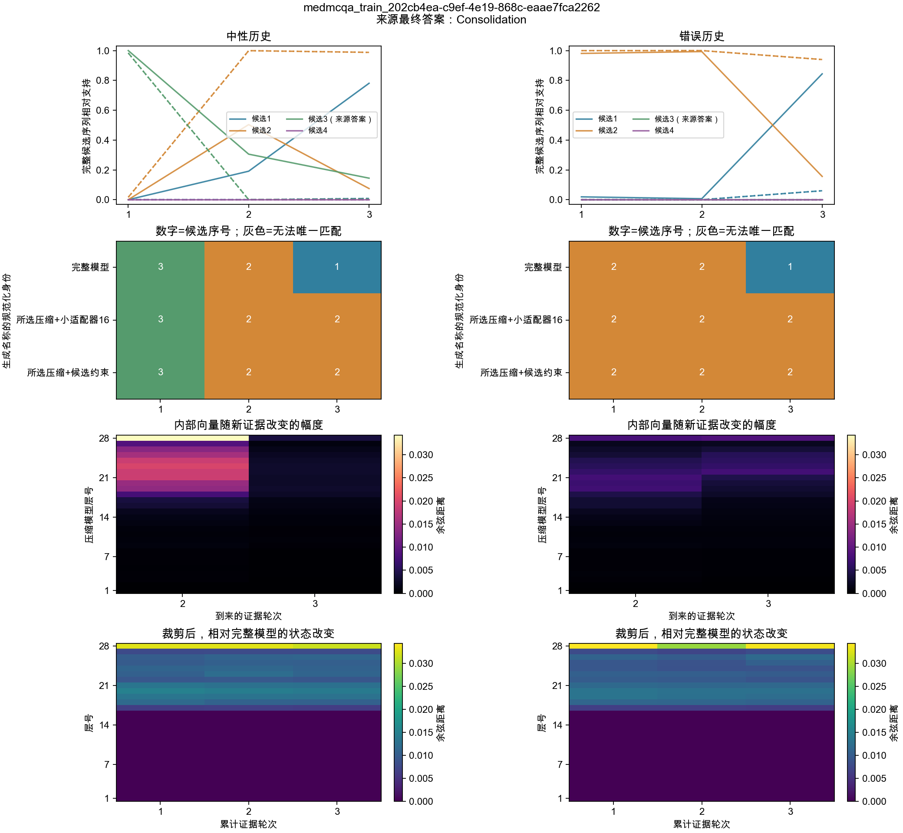

> 来源敏感性标记：missing_referenced_material。该例保留展示，但从严格子集统计中排除。

# medmcqa_train_202cb4ea-c9ef-4e19-868c-eaae7fca2262

来源：MedMCQA。最终来源答案：**Consolidation**。错误历史预设：Hydatid cyst。

候选：1. Hydatid cyst；2. Lung abscess；3. Consolidation；4. 'Thoracic duct malformations

实际诊断色块按统一表面写法后的候选身份绘制；逐字输出保留在下表与原文件。上图颜色按候选序号，实线=完整模型、虚线=压缩适配器、点线=第三个冻结方法。序列支持是四个完整字符串归一化后的模型分数，不是临床概率；遇到候选约束模型，则为受约束分布。内部距离只量化表示变化幅度，不能单独说明正朝哪个疾病变化；疾病方向以实际生成和完整候选支持观察。

| 轮次 | 新增事实（保留来源原文） |
|---|---|
| 1 | An 8-year-old child presents with the history of cough for 7 months. |
| 2 | He also gives a history of hemoptysis for 1 month and fever for 4 days. |
| 3 | The X-ray is given below. |

## 中性历史

| 轮次 | 方法 | 实际诊断 | 最终来源答案支持 | 错误历史诊断支持 |
|---|---|---|---:|---:|
| 1 | 完整模型 | Consolidation | 1.000 | 0.000 |
| 1 | 所选压缩+小适配器16 | Consolidation | 0.984 | 0.000 |
| 1 | 所选压缩+候选约束 | Consolidation | 0.984 | 0.000 |
| 2 | 完整模型 | Lung abscess | 0.305 | 0.191 |
| 2 | 所选压缩+小适配器16 | Lung abscess | 0.001 | 0.000 |
| 2 | 所选压缩+候选约束 | Lung abscess | 0.001 | 0.000 |
| 3 | 完整模型 | Hydatid cyst | 0.144 | 0.781 |
| 3 | 所选压缩+小适配器16 | Lung abscess | 0.004 | 0.008 |
| 3 | 所选压缩+候选约束 | Lung abscess | 0.004 | 0.008 |

## 错误历史

| 轮次 | 方法 | 实际诊断 | 最终来源答案支持 | 错误历史诊断支持 |
|---|---|---|---:|---:|
| 1 | 完整模型 | Lung abscess | 0.000 | 0.019 |
| 1 | 所选压缩+小适配器16 | Lung abscess | 0.000 | 0.000 |
| 1 | 所选压缩+候选约束 | Lung abscess | 0.000 | 0.000 |
| 2 | 完整模型 | Lung abscess | 0.000 | 0.007 |
| 2 | 所选压缩+小适配器16 | Lung abscess | 0.000 | 0.000 |
| 2 | 所选压缩+候选约束 | Lung abscess | 0.000 | 0.000 |
| 3 | 完整模型 | Hydatid cyst | 0.000 | 0.844 |
| 3 | 所选压缩+小适配器16 | Lung abscess | 0.000 | 0.060 |
| 3 | 所选压缩+候选约束 | Lung abscess | 0.000 | 0.060 |

原始逐轮生成、各层2048维状态和适配器前后向量见[runs轨迹目录](../../../runs/structural_v2/trajectories)。中间前缀没有独立诊断真值；“匹配来源答案”只描述是否提前到达最终答案。
