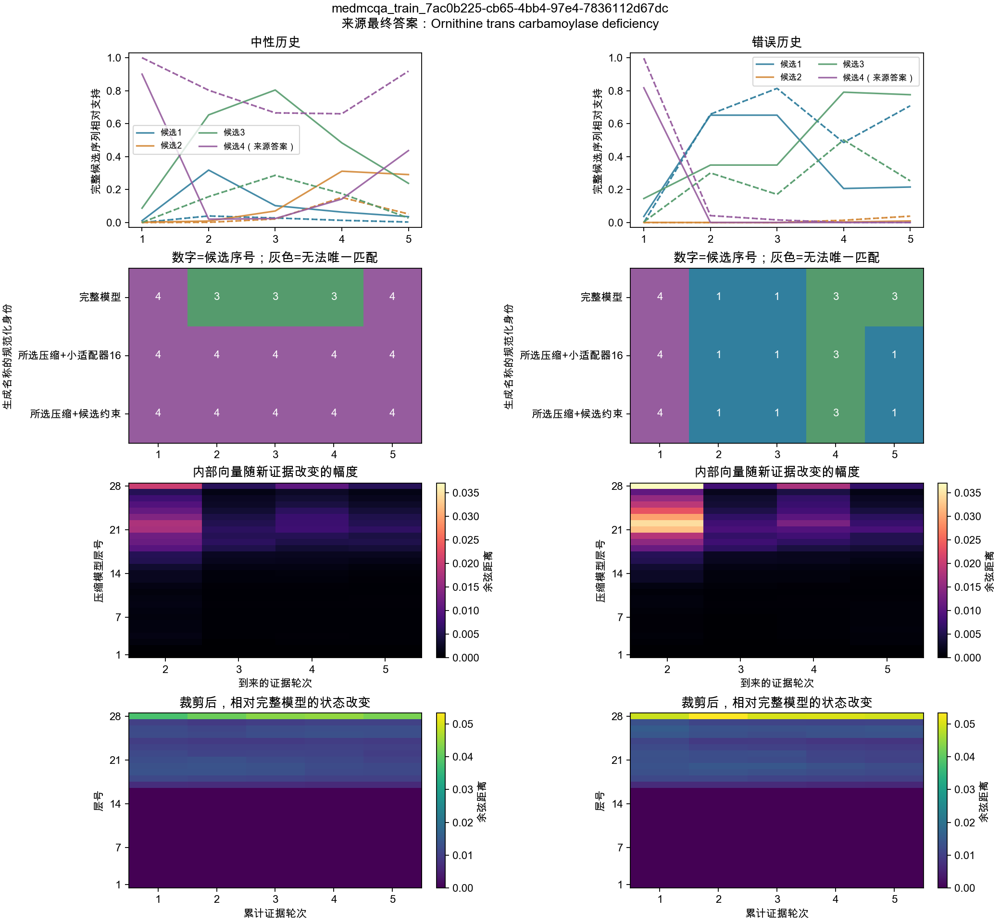

# medmcqa_train_7ac0b225-cb65-4bb4-97e4-7836112d67dc

来源：MedMCQA。最终来源答案：**Ornithine trans carbamoylase deficiency**。错误历史预设：CPS-I deficiency。

候选：1. CPS-I deficiency；2. Argino succinate synthetase deficiency；3. CPS-II deficiency；4. Ornithine trans carbamoylase deficiency

实际诊断色块按统一表面写法后的候选身份绘制；逐字输出保留在下表与原文件。上图颜色按候选序号，实线=完整模型、虚线=压缩适配器、点线=第三个冻结方法。序列支持是四个完整字符串归一化后的模型分数，不是临床概率；遇到候选约束模型，则为受约束分布。内部距离只量化表示变化幅度，不能单独说明正朝哪个疾病变化；疾病方向以实际生成和完整候选支持观察。

| 轮次 | 新增事实（保留来源原文） |
|---|---|
| 1 | A patient presented to casualty with nausea, vomiting. |
| 2 | Intravenous glucose was given & the patient recovered. |
| 3 | After few months, patient presented with same complaints. |
| 4 | Blood glutamine was found to be increased. |
| 5 | Also uracil levels were raised. |

## 中性历史

| 轮次 | 方法 | 实际诊断 | 最终来源答案支持 | 错误历史诊断支持 |
|---|---|---|---:|---:|
| 1 | 完整模型 | Ornithine trans carbamoylase deficiency | 0.900 | 0.011 |
| 1 | 所选压缩+小适配器16 | Ornithine trans carbamoylase deficiency | 0.999 | 0.000 |
| 1 | 所选压缩+候选约束 | Ornithine trans carbamoylase deficiency | 0.999 | 0.000 |
| 2 | 完整模型 | CPS-II deficiency | 0.020 | 0.318 |
| 2 | 所选压缩+小适配器16 | Ornithine trans carbamoylase deficiency | 0.802 | 0.040 |
| 2 | 所选压缩+候选约束 | Ornithine trans carbamoylase deficiency | 0.802 | 0.040 |
| 3 | 完整模型 | CPS-II deficiency | 0.024 | 0.102 |
| 3 | 所选压缩+小适配器16 | Ornithine trans carbamoylase deficiency | 0.665 | 0.027 |
| 3 | 所选压缩+候选约束 | Ornithine trans carbamoylase deficiency | 0.665 | 0.027 |
| 4 | 完整模型 | CPS-II deficiency | 0.142 | 0.063 |
| 4 | 所选压缩+小适配器16 | Ornithine trans carbamoylase deficiency | 0.660 | 0.013 |
| 4 | 所选压缩+候选约束 | Ornithine trans carbamoylase deficiency | 0.659 | 0.013 |
| 5 | 完整模型 | Ornithine trans carbamoylase deficiency | 0.436 | 0.035 |
| 5 | 所选压缩+小适配器16 | Ornithine trans carbamoylase deficiency | 0.918 | 0.003 |
| 5 | 所选压缩+候选约束 | Ornithine trans carbamoylase deficiency | 0.918 | 0.003 |

## 错误历史

| 轮次 | 方法 | 实际诊断 | 最终来源答案支持 | 错误历史诊断支持 |
|---|---|---|---:|---:|
| 1 | 完整模型 | Ornithine trans carbamoylase deficiency | 0.817 | 0.037 |
| 1 | 所选压缩+小适配器16 | Ornithine trans carbamoylase deficiency | 0.996 | 0.000 |
| 1 | 所选压缩+候选约束 | Ornithine trans carbamoylase deficiency | 0.996 | 0.000 |
| 2 | 完整模型 | CPS-I deficiency | 0.000 | 0.651 |
| 2 | 所选压缩+小适配器16 | CPS-I deficiency | 0.042 | 0.657 |
| 2 | 所选压缩+候选约束 | CPS-I deficiency | 0.042 | 0.657 |
| 3 | 完整模型 | CPS-I deficiency | 0.000 | 0.651 |
| 3 | 所选压缩+小适配器16 | CPS-I deficiency | 0.016 | 0.814 |
| 3 | 所选压缩+候选约束 | CPS-I deficiency | 0.016 | 0.814 |
| 4 | 完整模型 | CPS-II deficiency | 0.000 | 0.206 |
| 4 | 所选压缩+小适配器16 | CPS-II deficiency | 0.001 | 0.485 |
| 4 | 所选压缩+候选约束 | CPS-II deficiency | 0.001 | 0.485 |
| 5 | 完整模型 | CPS-II deficiency | 0.000 | 0.215 |
| 5 | 所选压缩+小适配器16 | CPS-I deficiency | 0.001 | 0.708 |
| 5 | 所选压缩+候选约束 | CPS-I deficiency | 0.001 | 0.708 |

原始逐轮生成、各层2048维状态和适配器前后向量见[runs轨迹目录](../../../runs/structural_v2/trajectories)。中间前缀没有独立诊断真值；“匹配来源答案”只描述是否提前到达最终答案。
