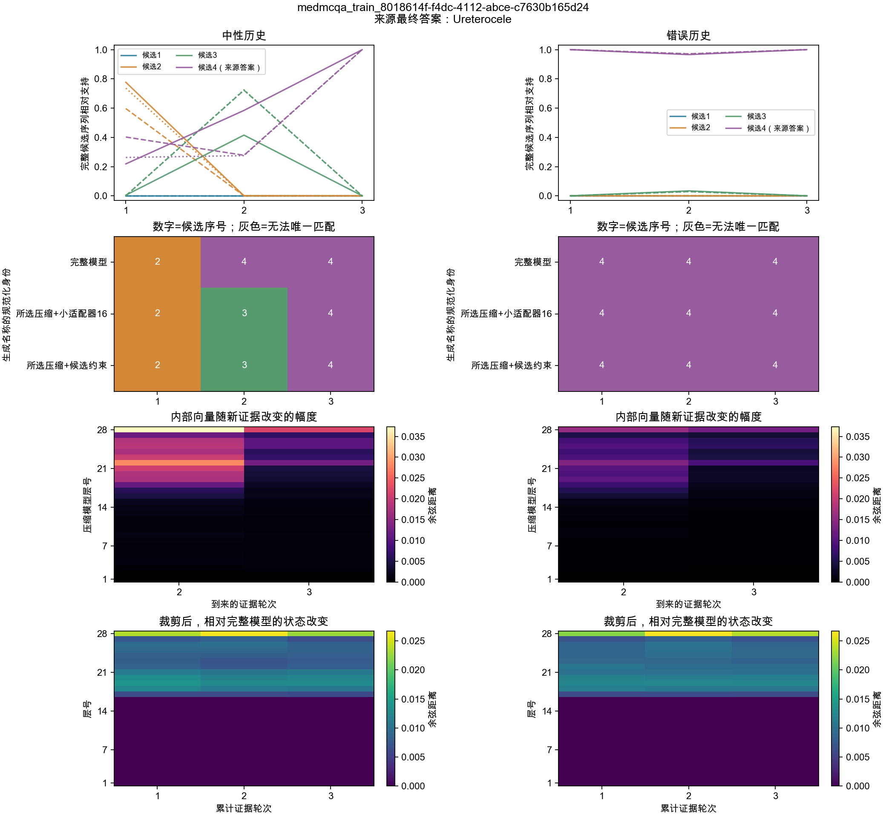

# medmcqa_train_8018614f-f4dc-4112-abce-c7630b165d24

来源：MedMCQA。最终来源答案：**Ureterocele**。错误历史预设：Vesicoureteric Reflux - grade II。

候选：1. Sacrococcygeal Teratoma；2. Vesicoureteric Reflux - grade II；3. Duplication of Ureter；4. Ureterocele

实际诊断色块按统一表面写法后的候选身份绘制；逐字输出保留在下表与原文件。上图颜色按候选序号，实线=完整模型、虚线=压缩适配器、点线=第三个冻结方法。序列支持是四个完整字符串归一化后的模型分数，不是临床概率；遇到候选约束模型，则为受约束分布。内部距离只量化表示变化幅度，不能单独说明正朝哪个疾病变化；疾病方向以实际生成和完整候选支持观察。

| 轮次 | 新增事实（保留来源原文） |
|---|---|
| 1 | A 6 year old girl presents with Recurrent E.coli infection in urine. |
| 2 | Ultrasound of abdomen shows Hydroureter and Hydronephrosis. |
| 3 | Micturating cysto - urethrogam shows filling defect in urinary bladder. |

## 中性历史

| 轮次 | 方法 | 实际诊断 | 最终来源答案支持 | 错误历史诊断支持 |
|---|---|---|---:|---:|
| 1 | 完整模型 | Vesicoureteric Reflux - grade II | 0.219 | 0.776 |
| 1 | 所选压缩+小适配器16 | Vesicoureteric Reflux - grade II | 0.402 | 0.597 |
| 1 | 所选压缩+候选约束 | Vesicoureteric Reflux - grade II | 0.263 | 0.737 |
| 2 | 完整模型 | Ureterocele | 0.584 | 0.000 |
| 2 | 所选压缩+小适配器16 | Duplication of Ureter | 0.278 | 0.000 |
| 2 | 所选压缩+候选约束 | Duplication of Ureter | 0.275 | 0.000 |
| 3 | 完整模型 | Ureterocele | 0.999 | 0.000 |
| 3 | 所选压缩+小适配器16 | Ureterocele | 1.000 | 0.000 |
| 3 | 所选压缩+候选约束 | Ureterocele | 1.000 | 0.000 |

## 错误历史

| 轮次 | 方法 | 实际诊断 | 最终来源答案支持 | 错误历史诊断支持 |
|---|---|---|---:|---:|
| 1 | 完整模型 | Ureterocele | 1.000 | 0.000 |
| 1 | 所选压缩+小适配器16 | Ureterocele | 1.000 | 0.000 |
| 1 | 所选压缩+候选约束 | Ureterocele | 1.000 | 0.000 |
| 2 | 完整模型 | Ureterocele | 0.966 | 0.000 |
| 2 | 所选压缩+小适配器16 | Ureterocele | 0.971 | 0.000 |
| 2 | 所选压缩+候选约束 | Ureterocele | 0.971 | 0.000 |
| 3 | 完整模型 | Ureterocele | 1.000 | 0.000 |
| 3 | 所选压缩+小适配器16 | Ureterocele | 1.000 | 0.000 |
| 3 | 所选压缩+候选约束 | Ureterocele | 1.000 | 0.000 |

原始逐轮生成、各层2048维状态和适配器前后向量见[runs轨迹目录](../../../runs/structural_v2/trajectories)。中间前缀没有独立诊断真值；“匹配来源答案”只描述是否提前到达最终答案。
