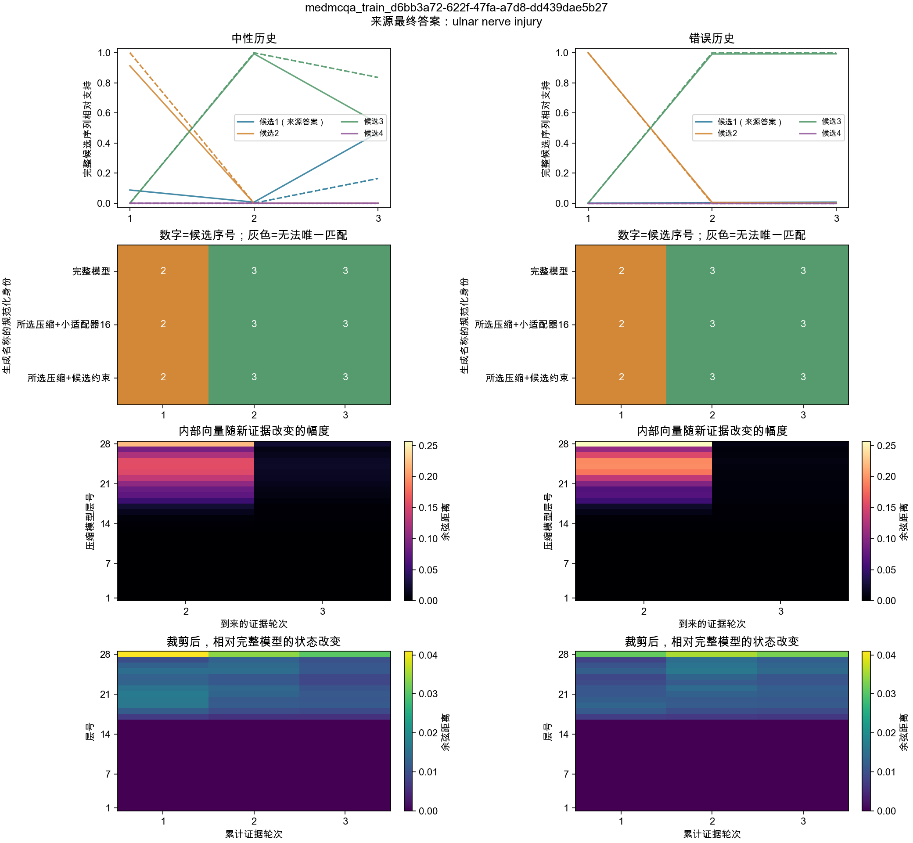

# medmcqa_train_d6bb3a72-622f-47fa-a7d8-dd439dae5b27

来源：MedMCQA。最终来源答案：**ulnar nerve injury**。错误历史预设：radial nerve injury。

候选：1. ulnar nerve injury；2. radial nerve injury；3. median nerve injury；4. carpal tunnel syndrome

实际诊断色块按统一表面写法后的候选身份绘制；逐字输出保留在下表与原文件。上图颜色按候选序号，实线=完整模型、虚线=压缩适配器、点线=第三个冻结方法。序列支持是四个完整字符串归一化后的模型分数，不是临床概率；遇到候选约束模型，则为受约束分布。内部距离只量化表示变化幅度，不能单独说明正朝哪个疾病变化；疾病方向以实际生成和完整候选支持观察。

| 轮次 | 新增事实（保留来源原文） |
|---|---|
| 1 | A 40-year-old man is injured in a car accident and fractures his left elbow. |
| 2 | He now complains of numbness of his fourth and fifth fingers, and weakness in his hand grip. |
| 3 | Neurologic findings confirm weakness of handgrip with weakness of finger abduction and adduction, and decreased sensation over the fifth finger and lateral aspect of fourth finger. |

## 中性历史

| 轮次 | 方法 | 实际诊断 | 最终来源答案支持 | 错误历史诊断支持 |
|---|---|---|---:|---:|
| 1 | 完整模型 | radial nerve injury | 0.088 | 0.912 |
| 1 | 所选压缩+小适配器16 | radial nerve injury | 0.001 | 0.999 |
| 1 | 所选压缩+候选约束 | radial nerve injury | 0.000 | 1.000 |
| 2 | 完整模型 | median nerve injury | 0.007 | 0.000 |
| 2 | 所选压缩+小适配器16 | median nerve injury | 0.001 | 0.000 |
| 2 | 所选压缩+候选约束 | median nerve injury | 0.001 | 0.000 |
| 3 | 完整模型 | median nerve injury | 0.469 | 0.000 |
| 3 | 所选压缩+小适配器16 | median nerve injury | 0.164 | 0.000 |
| 3 | 所选压缩+候选约束 | median nerve injury | 0.165 | 0.000 |

## 错误历史

| 轮次 | 方法 | 实际诊断 | 最终来源答案支持 | 错误历史诊断支持 |
|---|---|---|---:|---:|
| 1 | 完整模型 | radial nerve injury | 0.000 | 1.000 |
| 1 | 所选压缩+小适配器16 | radial nerve injury | 0.000 | 1.000 |
| 1 | 所选压缩+候选约束 | radial nerve injury | 0.000 | 1.000 |
| 2 | 完整模型 | median nerve injury | 0.004 | 0.005 |
| 2 | 所选压缩+小适配器16 | median nerve injury | 0.000 | 0.000 |
| 2 | 所选压缩+候选约束 | median nerve injury | 0.000 | 0.000 |
| 3 | 完整模型 | median nerve injury | 0.007 | 0.000 |
| 3 | 所选压缩+小适配器16 | median nerve injury | 0.000 | 0.000 |
| 3 | 所选压缩+候选约束 | median nerve injury | 0.000 | 0.000 |

原始逐轮生成、各层2048维状态和适配器前后向量见[runs轨迹目录](../../../runs/structural_v2/trajectories)。中间前缀没有独立诊断真值；“匹配来源答案”只描述是否提前到达最终答案。
