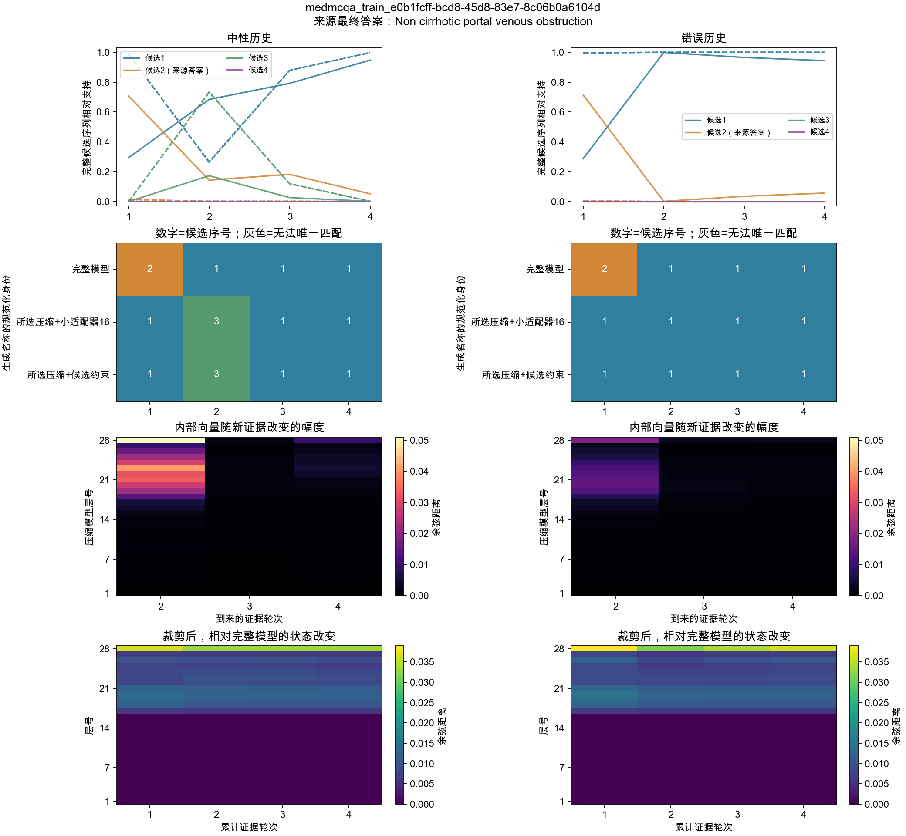

> 来源敏感性标记：与训练/开发/旧病例或另一确认病例文本相似度≥0.80。该例保留展示，但从严格子集统计中排除。

# medmcqa_train_e0b1fcff-bcd8-45d8-83e7-8c06b0a6104d

来源：MedMCQA。最终来源答案：**Non cirrhotic portal venous obstruction**。错误历史预设：Extrahepatic portal venous obstruction。

候选：1. Extrahepatic portal venous obstruction；2. Non cirrhotic portal venous obstruction；3. Cirrhosis；4. Hepatic venous outflow tract obstruction

实际诊断色块按统一表面写法后的候选身份绘制；逐字输出保留在下表与原文件。上图颜色按候选序号，实线=完整模型、虚线=压缩适配器、点线=第三个冻结方法。序列支持是四个完整字符串归一化后的模型分数，不是临床概率；遇到候选约束模型，则为受约束分布。内部距离只量化表示变化幅度，不能单独说明正朝哪个疾病变化；疾病方向以实际生成和完整候选支持观察。

| 轮次 | 新增事实（保留来源原文） |
|---|---|
| 1 | A 20 year old man presents with repeated episodes of hematemesis. there is no history of jaundice or liver decompensation. |
| 2 | On examination, the significan findings include moderate splenomegaly and presence of esophageal varices. |
| 3 | There is no ascites or peptic ulceration. |
| 4 | The liver function tests are normal. |

## 中性历史

| 轮次 | 方法 | 实际诊断 | 最终来源答案支持 | 错误历史诊断支持 |
|---|---|---|---:|---:|
| 1 | 完整模型 | Non cirrhotic portal venous obstruction | 0.706 | 0.294 |
| 1 | 所选压缩+小适配器16 | Extrahepatic portal venous obstruction | 0.014 | 0.986 |
| 1 | 所选压缩+候选约束 | Extrahepatic portal venous obstruction | 0.013 | 0.987 |
| 2 | 完整模型 | Extrahepatic portal venous obstruction | 0.143 | 0.684 |
| 2 | 所选压缩+小适配器16 | Cirrhosis | 0.002 | 0.262 |
| 2 | 所选压缩+候选约束 | Cirrhosis | 0.002 | 0.268 |
| 3 | 完整模型 | Extrahepatic portal venous obstruction | 0.182 | 0.791 |
| 3 | 所选压缩+小适配器16 | Extrahepatic portal venous obstruction | 0.002 | 0.878 |
| 3 | 所选压缩+候选约束 | Extrahepatic portal venous obstruction | 0.002 | 0.878 |
| 4 | 完整模型 | Extrahepatic portal venous obstruction | 0.052 | 0.947 |
| 4 | 所选压缩+小适配器16 | Extrahepatic portal venous obstruction | 0.000 | 0.998 |
| 4 | 所选压缩+候选约束 | Extrahepatic portal venous obstruction | 0.000 | 0.998 |

## 错误历史

| 轮次 | 方法 | 实际诊断 | 最终来源答案支持 | 错误历史诊断支持 |
|---|---|---|---:|---:|
| 1 | 完整模型 | Non cirrhotic portal venous obstruction | 0.712 | 0.288 |
| 1 | 所选压缩+小适配器16 | Extrahepatic portal venous obstruction | 0.005 | 0.995 |
| 1 | 所选压缩+候选约束 | Extrahepatic portal venous obstruction | 0.005 | 0.995 |
| 2 | 完整模型 | Extrahepatic portal venous obstruction | 0.001 | 0.999 |
| 2 | 所选压缩+小适配器16 | Extrahepatic portal venous obstruction | 0.000 | 1.000 |
| 2 | 所选压缩+候选约束 | Extrahepatic portal venous obstruction | 0.000 | 1.000 |
| 3 | 完整模型 | Extrahepatic portal venous obstruction | 0.035 | 0.965 |
| 3 | 所选压缩+小适配器16 | Extrahepatic portal venous obstruction | 0.000 | 1.000 |
| 3 | 所选压缩+候选约束 | Extrahepatic portal venous obstruction | 0.000 | 1.000 |
| 4 | 完整模型 | Extrahepatic portal venous obstruction | 0.057 | 0.943 |
| 4 | 所选压缩+小适配器16 | Extrahepatic portal venous obstruction | 0.000 | 1.000 |
| 4 | 所选压缩+候选约束 | Extrahepatic portal venous obstruction | 0.000 | 1.000 |

原始逐轮生成、各层2048维状态和适配器前后向量见[runs轨迹目录](../../../runs/structural_v2/trajectories)。中间前缀没有独立诊断真值；“匹配来源答案”只描述是否提前到达最终答案。
