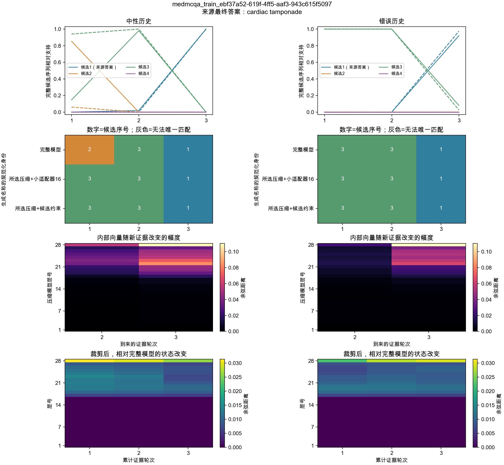

# medmcqa_train_ebf37a52-619f-4ff5-aaf3-943c615f5097

来源：MedMCQA。最终来源答案：**cardiac tamponade**。错误历史预设：ventricular septal defect。

候选：1. cardiac tamponade；2. pulmonary hypertension；3. ventricular septal defect；4. coarctation of the aorta

实际诊断色块按统一表面写法后的候选身份绘制；逐字输出保留在下表与原文件。上图颜色按候选序号，实线=完整模型、虚线=压缩适配器、点线=第三个冻结方法。序列支持是四个完整字符串归一化后的模型分数，不是临床概率；遇到候选约束模型，则为受约束分布。内部距离只量化表示变化幅度，不能单独说明正朝哪个疾病变化；疾病方向以实际生成和完整候选支持观察。

| 轮次 | 新增事实（保留来源原文） |
|---|---|
| 1 | A 34-year-old man presents with dyspnea and increasing peripheral edema. |
| 2 | He recently had a "flu-like" illness with intermittent sharp left-sided chest pain. |
| 3 | On examination, his jugular venous pressure (JVP) is elevated at 8 cm, heart sounds are soft, and the blood pressure (BP) is 104/76 mm Hg with a 20 mm Hg decrease in systolic arterial pressure during slow inspiration. |

## 中性历史

| 轮次 | 方法 | 实际诊断 | 最终来源答案支持 | 错误历史诊断支持 |
|---|---|---|---:|---:|
| 1 | 完整模型 | pulmonary hypertension | 0.000 | 0.148 |
| 1 | 所选压缩+小适配器16 | ventricular septal defect | 0.000 | 0.940 |
| 1 | 所选压缩+候选约束 | ventricular septal defect | 0.000 | 0.940 |
| 2 | 完整模型 | ventricular septal defect | 0.019 | 0.981 |
| 2 | 所选压缩+小适配器16 | ventricular septal defect | 0.000 | 1.000 |
| 2 | 所选压缩+候选约束 | ventricular septal defect | 0.000 | 1.000 |
| 3 | 完整模型 | cardiac tamponade | 1.000 | 0.000 |
| 3 | 所选压缩+小适配器16 | cardiac tamponade | 1.000 | 0.000 |
| 3 | 所选压缩+候选约束 | cardiac tamponade | 1.000 | 0.000 |

## 错误历史

| 轮次 | 方法 | 实际诊断 | 最终来源答案支持 | 错误历史诊断支持 |
|---|---|---|---:|---:|
| 1 | 完整模型 | ventricular septal defect | 0.000 | 1.000 |
| 1 | 所选压缩+小适配器16 | ventricular septal defect | 0.000 | 1.000 |
| 1 | 所选压缩+候选约束 | ventricular septal defect | 0.000 | 1.000 |
| 2 | 完整模型 | ventricular septal defect | 0.000 | 1.000 |
| 2 | 所选压缩+小适配器16 | ventricular septal defect | 0.000 | 1.000 |
| 2 | 所选压缩+候选约束 | ventricular septal defect | 0.000 | 1.000 |
| 3 | 完整模型 | cardiac tamponade | 0.920 | 0.080 |
| 3 | 所选压缩+小适配器16 | cardiac tamponade | 0.973 | 0.027 |
| 3 | 所选压缩+候选约束 | cardiac tamponade | 0.975 | 0.025 |

原始逐轮生成、各层2048维状态和适配器前后向量见[runs轨迹目录](../../../runs/structural_v2/trajectories)。中间前缀没有独立诊断真值；“匹配来源答案”只描述是否提前到达最终答案。
