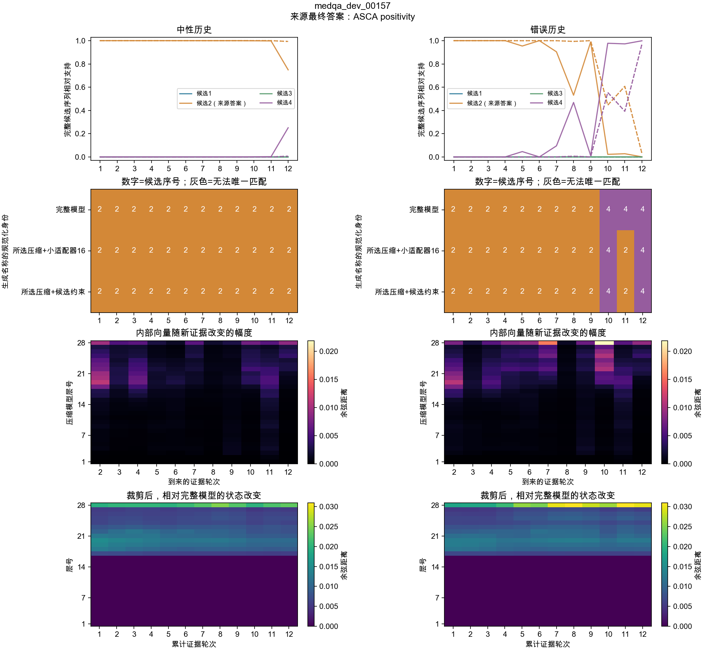

# medqa_dev_00157

来源：MedQA。最终来源答案：**ASCA positivity**。错误历史预设：Dilated vascular structure in the anal canal。

候选：1. ANCA positivity；2. ASCA positivity；3. Dilated vascular structure in the anal c；4. Mucosal disruption

实际诊断色块按统一表面写法后的候选身份绘制；逐字输出保留在下表与原文件。上图颜色按候选序号，实线=完整模型、虚线=压缩适配器、点线=第三个冻结方法。序列支持是四个完整字符串归一化后的模型分数，不是临床概率；遇到候选约束模型，则为受约束分布。内部距离只量化表示变化幅度，不能单独说明正朝哪个疾病变化；疾病方向以实际生成和完整候选支持观察。

| 轮次 | 新增事实（保留来源原文） |
|---|---|
| 1 | A 27-year-old man presents to the emergency department with a chief concern of abdominal pain and diarrhea. |
| 2 | The patient states that for the past 4 days he has experienced abdominal pain, diarrhea, weakness and a subjective fever. |
| 3 | He also endorses a weight loss of 11 pounds during this time. |
| 4 | The patient has a past medical history of celiac disease, constipation, and depression. |
| 5 | His current medications include fish oil, a multivitamin, sodium docusate, and fluoxetine. |
| 6 | His temperature is 98.5°F (36.9°C), blood pressure is 110/75 mmHg, pulse is 90/min, respirations are 13/min, and oxygen saturation is 98% on room air. |
| 7 | Physical exam is notable for a young man in mild distress. |
| 8 | Cardiac and pulmonary exams are within normal limits. |
| 9 | Abdominal exam is notable for generalized tenderness and increased bowel sounds. |
| 10 | Oral exam is notable for multiple shallow painful ulcers. |
| 11 | Laboratory values are ordered as seen below:  Hemoglobin: 12 g/dL Hematocrit: 36% Leukocyte count: 8,000 cells/mm^3 with normal differential Platelet count: 227,500/mm^3  Serum: Na+: 141 mEq/L Cl-: 101 mEq/L K+: 4.5 mEq/L HCO3-: 24 mEq/L BUN: 17 mg/dL Glucose: 82 mg/dL Creatinine: 1.0 mg/dL Ca2+: 10.1 mg/dL AST: 12 U/L ALT: 11 U/L  A stool guaiac test is performed which returns positive. |
| 12 | The patient is started on IV fluids and morphine. |

## 中性历史

| 轮次 | 方法 | 实际诊断 | 最终来源答案支持 | 错误历史诊断支持 |
|---|---|---|---:|---:|
| 1 | 完整模型 | ASCA positivity | 1.000 | 0.000 |
| 1 | 所选压缩+小适配器16 | ASCA positivity | 1.000 | 0.000 |
| 1 | 所选压缩+候选约束 | ASCA positivity | 1.000 | 0.000 |
| 2 | 完整模型 | ASCA positivity | 1.000 | 0.000 |
| 2 | 所选压缩+小适配器16 | ASCA positivity | 1.000 | 0.000 |
| 2 | 所选压缩+候选约束 | ASCA positivity | 1.000 | 0.000 |
| 3 | 完整模型 | ASCA positivity | 1.000 | 0.000 |
| 3 | 所选压缩+小适配器16 | ASCA positivity | 1.000 | 0.000 |
| 3 | 所选压缩+候选约束 | ASCA positivity | 1.000 | 0.000 |
| 4 | 完整模型 | ASCA positivity | 1.000 | 0.000 |
| 4 | 所选压缩+小适配器16 | ASCA positivity | 1.000 | 0.000 |
| 4 | 所选压缩+候选约束 | ASCA positivity | 1.000 | 0.000 |
| 5 | 完整模型 | ASCA positivity | 1.000 | 0.000 |
| 5 | 所选压缩+小适配器16 | ASCA positivity | 1.000 | 0.000 |
| 5 | 所选压缩+候选约束 | ASCA positivity | 1.000 | 0.000 |
| 6 | 完整模型 | ASCA positivity | 1.000 | 0.000 |
| 6 | 所选压缩+小适配器16 | ASCA positivity | 1.000 | 0.000 |
| 6 | 所选压缩+候选约束 | ASCA positivity | 1.000 | 0.000 |
| 7 | 完整模型 | ASCA positivity | 1.000 | 0.000 |
| 7 | 所选压缩+小适配器16 | ASCA positivity | 1.000 | 0.000 |
| 7 | 所选压缩+候选约束 | ASCA positivity | 1.000 | 0.000 |
| 8 | 完整模型 | ASCA positivity | 1.000 | 0.000 |
| 8 | 所选压缩+小适配器16 | ASCA positivity | 1.000 | 0.000 |
| 8 | 所选压缩+候选约束 | ASCA positivity | 1.000 | 0.000 |
| 9 | 完整模型 | ASCA positivity | 1.000 | 0.000 |
| 9 | 所选压缩+小适配器16 | ASCA positivity | 1.000 | 0.000 |
| 9 | 所选压缩+候选约束 | ASCA positivity | 1.000 | 0.000 |
| 10 | 完整模型 | ASCA positivity | 0.999 | 0.000 |
| 10 | 所选压缩+小适配器16 | ASCA positivity | 1.000 | 0.000 |
| 10 | 所选压缩+候选约束 | ASCA positivity | 1.000 | 0.000 |
| 11 | 完整模型 | ASCA positivity | 0.998 | 0.000 |
| 11 | 所选压缩+小适配器16 | ASCA positivity | 1.000 | 0.000 |
| 11 | 所选压缩+候选约束 | ASCA positivity | 1.000 | 0.000 |
| 12 | 完整模型 | ASCA positivity | 0.749 | 0.000 |
| 12 | 所选压缩+小适配器16 | ASCA positivity | 0.993 | 0.000 |
| 12 | 所选压缩+候选约束 | ASCA positivity | 0.993 | 0.000 |

## 错误历史

| 轮次 | 方法 | 实际诊断 | 最终来源答案支持 | 错误历史诊断支持 |
|---|---|---|---:|---:|
| 1 | 完整模型 | ASCA positivity | 1.000 | 0.000 |
| 1 | 所选压缩+小适配器16 | ASCA positivity | 1.000 | 0.000 |
| 1 | 所选压缩+候选约束 | ASCA positivity | 1.000 | 0.000 |
| 2 | 完整模型 | ASCA positivity | 1.000 | 0.000 |
| 2 | 所选压缩+小适配器16 | ASCA positivity | 1.000 | 0.000 |
| 2 | 所选压缩+候选约束 | ASCA positivity | 1.000 | 0.000 |
| 3 | 完整模型 | ASCA positivity | 1.000 | 0.000 |
| 3 | 所选压缩+小适配器16 | ASCA positivity | 1.000 | 0.000 |
| 3 | 所选压缩+候选约束 | ASCA positivity | 1.000 | 0.000 |
| 4 | 完整模型 | ASCA positivity | 1.000 | 0.000 |
| 4 | 所选压缩+小适配器16 | ASCA positivity | 1.000 | 0.000 |
| 4 | 所选压缩+候选约束 | ASCA positivity | 1.000 | 0.000 |
| 5 | 完整模型 | ASCA positivity | 0.954 | 0.000 |
| 5 | 所选压缩+小适配器16 | ASCA positivity | 0.999 | 0.000 |
| 5 | 所选压缩+候选约束 | ASCA positivity | 0.999 | 0.000 |
| 6 | 完整模型 | ASCA positivity | 1.000 | 0.000 |
| 6 | 所选压缩+小适配器16 | ASCA positivity | 1.000 | 0.000 |
| 6 | 所选压缩+候选约束 | ASCA positivity | 1.000 | 0.000 |
| 7 | 完整模型 | ASCA positivity | 0.904 | 0.000 |
| 7 | 所选压缩+小适配器16 | ASCA positivity | 0.999 | 0.000 |
| 7 | 所选压缩+候选约束 | ASCA positivity | 0.999 | 0.000 |
| 8 | 完整模型 | ASCA positivity | 0.531 | 0.000 |
| 8 | 所选压缩+小适配器16 | ASCA positivity | 0.994 | 0.000 |
| 8 | 所选压缩+候选约束 | ASCA positivity | 0.994 | 0.000 |
| 9 | 完整模型 | ASCA positivity | 0.988 | 0.000 |
| 9 | 所选压缩+小适配器16 | ASCA positivity | 1.000 | 0.000 |
| 9 | 所选压缩+候选约束 | ASCA positivity | 1.000 | 0.000 |
| 10 | 完整模型 | Mucosal disruption | 0.022 | 0.000 |
| 10 | 所选压缩+小适配器16 | Mucosal disruption | 0.445 | 0.000 |
| 10 | 所选压缩+候选约束 | Mucosal disruption | 0.446 | 0.000 |
| 11 | 完整模型 | Mucosal disruption | 0.028 | 0.000 |
| 11 | 所选压缩+小适配器16 | ASCA positivity | 0.608 | 0.000 |
| 11 | 所选压缩+候选约束 | ASCA positivity | 0.608 | 0.000 |
| 12 | 完整模型 | Mucosal disruption | 0.001 | 0.000 |
| 12 | 所选压缩+小适配器16 | Mucosal disruption | 0.030 | 0.000 |
| 12 | 所选压缩+候选约束 | Mucosal disruption | 0.030 | 0.000 |

原始逐轮生成、各层2048维状态和适配器前后向量见[runs轨迹目录](../../../runs/structural_v2/trajectories)。中间前缀没有独立诊断真值；“匹配来源答案”只描述是否提前到达最终答案。
