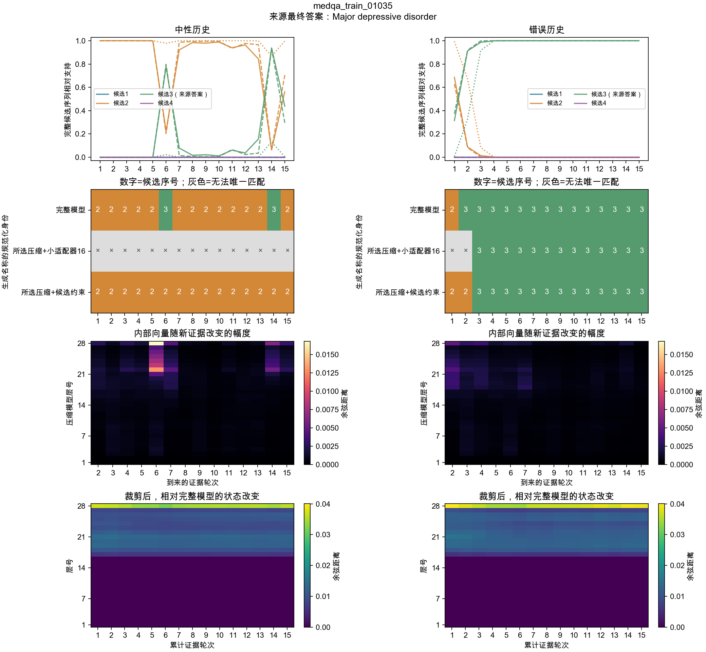

# medqa_train_01035

来源：MedQA。最终来源答案：**Major depressive disorder**。错误历史预设：Adjustment disorder。

候选：1. Disruptive mood dysregulation disorder；2. Adjustment disorder；3. Major depressive disorder；4. Normal behavior

实际诊断色块按统一表面写法后的候选身份绘制；逐字输出保留在下表与原文件。上图颜色按候选序号，实线=完整模型、虚线=压缩适配器、点线=第三个冻结方法。序列支持是四个完整字符串归一化后的模型分数，不是临床概率；遇到候选约束模型，则为受约束分布。内部距离只量化表示变化幅度，不能单独说明正朝哪个疾病变化；疾病方向以实际生成和完整候选支持观察。

| 轮次 | 新增事实（保留来源原文） |
|---|---|
| 1 | A 25-year-old woman comes to the physician because of sadness that started 6 weeks after her 9-month-old daughter was born. |
| 2 | Since then, she has not returned to work. |
| 3 | Her daughter usually sleeps through the night, but the patient still has difficulty staying asleep. |
| 4 | She is easily distracted from normal daily tasks. |
| 5 | She used to enjoy cooking, but only orders delivery or take-out now. |
| 6 | She says that she always feels too exhausted to do so and does not feel hungry much anyway. |
| 7 | The pregnancy of the patient's child was complicated by gestational diabetes. |
| 8 | The child was born at 36-weeks' gestation and has had no medical issues. |
| 9 | The patient has no contact with the child's father. |
| 10 | She is not sexually active. |
| 11 | She does not smoke, drink alcohol, or use illicit drugs. |
| 12 | She is 157 cm (5 ft 1 in) tall and weighs 47 kg (105 lb); BMI is 20 kg/m2. |
| 13 | Vital signs are within normal limits. |
| 14 | She is alert and cooperative but makes little eye contact. |
| 15 | Physical examination shows no abnormalities. |

## 中性历史

| 轮次 | 方法 | 实际诊断 | 最终来源答案支持 | 错误历史诊断支持 |
|---|---|---|---:|---:|
| 1 | 完整模型 | Adjustment disorder | 0.000 | 1.000 |
| 1 | 所选压缩+小适配器16 | Adjustation disorder | 0.000 | 1.000 |
| 1 | 所选压缩+候选约束 | Adjustment disorder | 0.000 | 1.000 |
| 2 | 完整模型 | Adjustment disorder | 0.000 | 1.000 |
| 2 | 所选压缩+小适配器16 | Adjustation disorder | 0.000 | 1.000 |
| 2 | 所选压缩+候选约束 | Adjustment disorder | 0.000 | 1.000 |
| 3 | 完整模型 | Adjustment disorder | 0.000 | 1.000 |
| 3 | 所选压缩+小适配器16 | Adjustation disorder | 0.000 | 1.000 |
| 3 | 所选压缩+候选约束 | Adjustment disorder | 0.000 | 1.000 |
| 4 | 完整模型 | Adjustment disorder | 0.000 | 1.000 |
| 4 | 所选压缩+小适配器16 | Adjustation disorder | 0.000 | 1.000 |
| 4 | 所选压缩+候选约束 | Adjustment disorder | 0.000 | 1.000 |
| 5 | 完整模型 | Adjustment disorder | 0.001 | 0.999 |
| 5 | 所选压缩+小适配器16 | Adjustation disorder | 0.001 | 0.999 |
| 5 | 所选压缩+候选约束 | Adjustment disorder | 0.000 | 1.000 |
| 6 | 完整模型 | Major depressive disorder | 0.777 | 0.223 |
| 6 | 所选压缩+小适配器16 | Adjustation disorder | 0.798 | 0.202 |
| 6 | 所选压缩+候选约束 | Adjustment disorder | 0.022 | 0.978 |
| 7 | 完整模型 | Adjustment disorder | 0.078 | 0.922 |
| 7 | 所选压缩+小适配器16 | Adjustation disorder | 0.014 | 0.986 |
| 7 | 所选压缩+候选约束 | Adjustment disorder | 0.000 | 1.000 |
| 8 | 完整模型 | Adjustment disorder | 0.016 | 0.984 |
| 8 | 所选压缩+小适配器16 | Adjustation disorder | 0.006 | 0.994 |
| 8 | 所选压缩+候选约束 | Adjustment disorder | 0.000 | 1.000 |
| 9 | 完整模型 | Adjustment disorder | 0.021 | 0.979 |
| 9 | 所选压缩+小适配器16 | Adjustation disorder | 0.004 | 0.996 |
| 9 | 所选压缩+候选约束 | Adjustment disorder | 0.000 | 1.000 |
| 10 | 完整模型 | Adjustment disorder | 0.011 | 0.989 |
| 10 | 所选压缩+小适配器16 | Adjustation disorder | 0.004 | 0.996 |
| 10 | 所选压缩+候选约束 | Adjustment disorder | 0.000 | 1.000 |
| 11 | 完整模型 | Adjustment disorder | 0.060 | 0.940 |
| 11 | 所选压缩+小适配器16 | Adjustation disorder | 0.065 | 0.935 |
| 11 | 所选压缩+候选约束 | Adjustment disorder | 0.000 | 1.000 |
| 12 | 完整模型 | Adjustment disorder | 0.036 | 0.964 |
| 12 | 所选压缩+小适配器16 | Adjustation disorder | 0.023 | 0.977 |
| 12 | 所选压缩+候选约束 | Adjustment disorder | 0.000 | 1.000 |
| 13 | 完整模型 | Adjustment disorder | 0.156 | 0.844 |
| 13 | 所选压缩+小适配器16 | Adjustation disorder | 0.034 | 0.966 |
| 13 | 所选压缩+候选约束 | Adjustment disorder | 0.000 | 1.000 |
| 14 | 完整模型 | Major depressive disorder | 0.938 | 0.062 |
| 14 | 所选压缩+小适配器16 | Adjustation disorder | 0.935 | 0.065 |
| 14 | 所选压缩+候选约束 | Adjustment disorder | 0.133 | 0.867 |
| 15 | 完整模型 | Adjustment disorder | 0.438 | 0.562 |
| 15 | 所选压缩+小适配器16 | Adjustation disorder | 0.295 | 0.705 |
| 15 | 所选压缩+候选约束 | Adjustment disorder | 0.002 | 0.998 |

## 错误历史

| 轮次 | 方法 | 实际诊断 | 最终来源答案支持 | 错误历史诊断支持 |
|---|---|---|---:|---:|
| 1 | 完整模型 | Adjustment disorder | 0.314 | 0.686 |
| 1 | 所选压缩+小适配器16 | Adjustation disorder | 0.372 | 0.628 |
| 1 | 所选压缩+候选约束 | Adjustment disorder | 0.006 | 0.994 |
| 2 | 完整模型 | Major depressive disorder | 0.912 | 0.088 |
| 2 | 所选压缩+小适配器16 | Adjustation disorder | 0.918 | 0.082 |
| 2 | 所选压缩+候选约束 | Adjustment disorder | 0.328 | 0.672 |
| 3 | 完整模型 | Major depressive disorder | 0.987 | 0.013 |
| 3 | 所选压缩+小适配器16 | Major depressive disorder | 0.998 | 0.002 |
| 3 | 所选压缩+候选约束 | Major depressive disorder | 0.917 | 0.083 |
| 4 | 完整模型 | Major depressive disorder | 0.999 | 0.001 |
| 4 | 所选压缩+小适配器16 | Major depressive disorder | 1.000 | 0.000 |
| 4 | 所选压缩+候选约束 | Major depressive disorder | 0.999 | 0.001 |
| 5 | 完整模型 | Major depressive disorder | 1.000 | 0.000 |
| 5 | 所选压缩+小适配器16 | Major depressive disorder | 1.000 | 0.000 |
| 5 | 所选压缩+候选约束 | Major depressive disorder | 1.000 | 0.000 |
| 6 | 完整模型 | Major depressive disorder | 1.000 | 0.000 |
| 6 | 所选压缩+小适配器16 | Major depressive disorder | 1.000 | 0.000 |
| 6 | 所选压缩+候选约束 | Major depressive disorder | 1.000 | 0.000 |
| 7 | 完整模型 | Major depressive disorder | 1.000 | 0.000 |
| 7 | 所选压缩+小适配器16 | Major depressive disorder | 1.000 | 0.000 |
| 7 | 所选压缩+候选约束 | Major depressive disorder | 1.000 | 0.000 |
| 8 | 完整模型 | Major depressive disorder | 1.000 | 0.000 |
| 8 | 所选压缩+小适配器16 | Major depressive disorder | 1.000 | 0.000 |
| 8 | 所选压缩+候选约束 | Major depressive disorder | 1.000 | 0.000 |
| 9 | 完整模型 | Major depressive disorder | 1.000 | 0.000 |
| 9 | 所选压缩+小适配器16 | Major depressive disorder | 1.000 | 0.000 |
| 9 | 所选压缩+候选约束 | Major depressive disorder | 1.000 | 0.000 |
| 10 | 完整模型 | Major depressive disorder | 1.000 | 0.000 |
| 10 | 所选压缩+小适配器16 | Major depressive disorder | 1.000 | 0.000 |
| 10 | 所选压缩+候选约束 | Major depressive disorder | 1.000 | 0.000 |
| 11 | 完整模型 | Major depressive disorder | 1.000 | 0.000 |
| 11 | 所选压缩+小适配器16 | Major depressive disorder | 1.000 | 0.000 |
| 11 | 所选压缩+候选约束 | Major depressive disorder | 1.000 | 0.000 |
| 12 | 完整模型 | Major depressive disorder | 1.000 | 0.000 |
| 12 | 所选压缩+小适配器16 | Major depressive disorder | 1.000 | 0.000 |
| 12 | 所选压缩+候选约束 | Major depressive disorder | 1.000 | 0.000 |
| 13 | 完整模型 | Major depressive disorder | 1.000 | 0.000 |
| 13 | 所选压缩+小适配器16 | Major depressive disorder | 1.000 | 0.000 |
| 13 | 所选压缩+候选约束 | Major depressive disorder | 1.000 | 0.000 |
| 14 | 完整模型 | Major depressive disorder | 1.000 | 0.000 |
| 14 | 所选压缩+小适配器16 | Major depressive disorder | 1.000 | 0.000 |
| 14 | 所选压缩+候选约束 | Major depressive disorder | 1.000 | 0.000 |
| 15 | 完整模型 | Major depressive disorder | 1.000 | 0.000 |
| 15 | 所选压缩+小适配器16 | Major depressive disorder | 1.000 | 0.000 |
| 15 | 所选压缩+候选约束 | Major depressive disorder | 1.000 | 0.000 |

原始逐轮生成、各层2048维状态和适配器前后向量见[runs轨迹目录](../../../runs/structural_v2/trajectories)。中间前缀没有独立诊断真值；“匹配来源答案”只描述是否提前到达最终答案。
