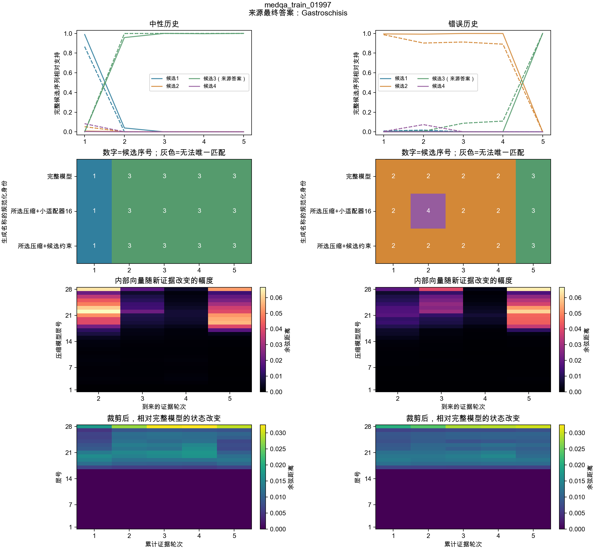

# medqa_train_01997

来源：MedQA。最终来源答案：**Gastroschisis**。错误历史预设：Vesicourachal diverticulum。

候选：1. Umbilical hernia；2. Vesicourachal diverticulum；3. Gastroschisis；4. Omphalocele

实际诊断色块按统一表面写法后的候选身份绘制；逐字输出保留在下表与原文件。上图颜色按候选序号，实线=完整模型、虚线=压缩适配器、点线=第三个冻结方法。序列支持是四个完整字符串归一化后的模型分数，不是临床概率；遇到候选约束模型，则为受约束分布。内部距离只量化表示变化幅度，不能单独说明正朝哪个疾病变化；疾病方向以实际生成和完整候选支持观察。

| 轮次 | 新增事实（保留来源原文） |
|---|---|
| 1 | A 19-year-old woman, gravida 1, para 0, at 21 weeks’ gestation comes to the physician for a follow-up prenatal visit. |
| 2 | At her previous appointment, her serum α-fetoprotein concentration was elevated. |
| 3 | She had smoked 1 pack of cigarettes daily for 3 years but quit at 6 weeks' gestation. |
| 4 | Examination shows a uterus consistent in size with a 21-week gestation. |
| 5 | Ultrasonography shows fetal viscera suspended freely into the amniotic cavity. |

## 中性历史

| 轮次 | 方法 | 实际诊断 | 最终来源答案支持 | 错误历史诊断支持 |
|---|---|---|---:|---:|
| 1 | 完整模型 | Umbilical hernia | 0.000 | 0.008 |
| 1 | 所选压缩+小适配器16 | Umbilical hernia | 0.000 | 0.052 |
| 1 | 所选压缩+候选约束 | Umbilical hernia | 0.000 | 0.052 |
| 2 | 完整模型 | Gastroschisis | 0.958 | 0.002 |
| 2 | 所选压缩+小适配器16 | Gastroschisis | 0.999 | 0.000 |
| 2 | 所选压缩+候选约束 | Gastroschisis | 0.999 | 0.000 |
| 3 | 完整模型 | Gastroschisis | 1.000 | 0.000 |
| 3 | 所选压缩+小适配器16 | Gastroschisis | 1.000 | 0.000 |
| 3 | 所选压缩+候选约束 | Gastroschisis | 1.000 | 0.000 |
| 4 | 完整模型 | Gastroschisis | 0.997 | 0.001 |
| 4 | 所选压缩+小适配器16 | Gastroschisis | 1.000 | 0.000 |
| 4 | 所选压缩+候选约束 | Gastroschisis | 1.000 | 0.000 |
| 5 | 完整模型 | Gastroschisis | 1.000 | 0.000 |
| 5 | 所选压缩+小适配器16 | Gastroschisis | 1.000 | 0.000 |
| 5 | 所选压缩+候选约束 | Gastroschisis | 1.000 | 0.000 |

## 错误历史

| 轮次 | 方法 | 实际诊断 | 最终来源答案支持 | 错误历史诊断支持 |
|---|---|---|---:|---:|
| 1 | 完整模型 | Vesicourachal diverticulum | 0.000 | 0.995 |
| 1 | 所选压缩+小适配器16 | Vesicourachal diverticulum | 0.000 | 0.987 |
| 1 | 所选压缩+候选约束 | Vesicourachal diverticulum | 0.000 | 0.986 |
| 2 | 完整模型 | Vesicourachal diverticulum | 0.000 | 0.992 |
| 2 | 所选压缩+小适配器16 | Omphalocele | 0.007 | 0.902 |
| 2 | 所选压缩+候选约束 | Vesicourachal diverticulum | 0.006 | 0.901 |
| 3 | 完整模型 | Vesicourachal diverticulum | 0.001 | 0.999 |
| 3 | 所选压缩+小适配器16 | Vesicourachal diverticulum | 0.088 | 0.912 |
| 3 | 所选压缩+候选约束 | Vesicourachal diverticulum | 0.088 | 0.912 |
| 4 | 完整模型 | Vesicourachal diverticulum | 0.001 | 0.999 |
| 4 | 所选压缩+小适配器16 | Vesicourachal diverticulum | 0.109 | 0.891 |
| 4 | 所选压缩+候选约束 | Vesicourachal diverticulum | 0.110 | 0.890 |
| 5 | 完整模型 | Gastroschisis | 1.000 | 0.000 |
| 5 | 所选压缩+小适配器16 | Gastroschisis | 1.000 | 0.000 |
| 5 | 所选压缩+候选约束 | Gastroschisis | 1.000 | 0.000 |

原始逐轮生成、各层2048维状态和适配器前后向量见[runs轨迹目录](../../../runs/structural_v2/trajectories)。中间前缀没有独立诊断真值；“匹配来源答案”只描述是否提前到达最终答案。
