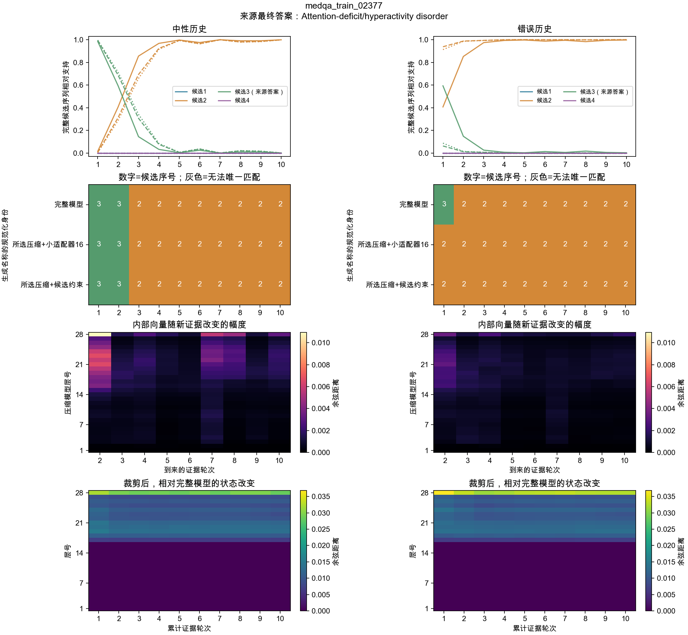

# medqa_train_02377

来源：MedQA。最终来源答案：**Attention-deficit/hyperactivity disorder**。错误历史预设：Age-appropriate behavior。

候选：1. Age-appropriate behavior；2. Oppositional defiant disorder；3. Attention-deficit/hyperactivity disorder；4. Hearing impairment

实际诊断色块按统一表面写法后的候选身份绘制；逐字输出保留在下表与原文件。上图颜色按候选序号，实线=完整模型、虚线=压缩适配器、点线=第三个冻结方法。序列支持是四个完整字符串归一化后的模型分数，不是临床概率；遇到候选约束模型，则为受约束分布。内部距离只量化表示变化幅度，不能单独说明正朝哪个疾病变化；疾病方向以实际生成和完整候选支持观察。

| 轮次 | 新增事实（保留来源原文） |
|---|---|
| 1 | An 8-year-old boy is brought to the physician by his foster mother because of complaints from his teachers regarding poor performance at school for the past 8 months. |
| 2 | He does not listen to their instructions, often talks during class, and rarely completes his school assignments. |
| 3 | He does not sit in his seat in the classroom and often cuts in line at the cafeteria. |
| 4 | His foster mother reports that he runs around a lot inside the house and refuses to help his sister with chores and errands. |
| 5 | He frequently interrupts his foster mother's conversations with others and talks excessively. |
| 6 | She has found him trying to climb on the roof on multiple occasions. |
| 7 | He was placed in foster care because of neglect by his biological parents 3 years ago. |
| 8 | Physical examination shows no abnormalities. |
| 9 | Neurologic examination shows no focal findings. |
| 10 | Mental status examination shows a neutral affect. |

## 中性历史

| 轮次 | 方法 | 实际诊断 | 最终来源答案支持 | 错误历史诊断支持 |
|---|---|---|---:|---:|
| 1 | 完整模型 | Attention-deficit/hyperactivity disorder | 0.984 | 0.000 |
| 1 | 所选压缩+小适配器16 | Attention-deficit/hyperactivity disorder | 0.994 | 0.000 |
| 1 | 所选压缩+候选约束 | Attention-deficit/hyperactivity disorder | 0.996 | 0.000 |
| 2 | 完整模型 | Attention-deficit/hyperactivity disorder | 0.593 | 0.000 |
| 2 | 所选压缩+小适配器16 | Attention-deficit/hyperactivity disorder | 0.687 | 0.000 |
| 2 | 所选压缩+候选约束 | Attention-deficit/hyperactivity disorder | 0.712 | 0.000 |
| 3 | 完整模型 | Oppositional defiant disorder | 0.145 | 0.000 |
| 3 | 所选压缩+小适配器16 | Oppositional defiant disorder | 0.307 | 0.000 |
| 3 | 所选压缩+候选约束 | Oppositional defiant disorder | 0.342 | 0.000 |
| 4 | 完整模型 | Oppositional defiant disorder | 0.033 | 0.000 |
| 4 | 所选压缩+小适配器16 | Oppositional defiant disorder | 0.077 | 0.000 |
| 4 | 所选压缩+候选约束 | Oppositional defiant disorder | 0.085 | 0.000 |
| 5 | 完整模型 | Oppositional defiant disorder | 0.003 | 0.000 |
| 5 | 所选压缩+小适配器16 | Oppositional defiant disorder | 0.006 | 0.000 |
| 5 | 所选压缩+候选约束 | Oppositional defiant disorder | 0.007 | 0.000 |
| 6 | 完整模型 | Oppositional defiant disorder | 0.025 | 0.000 |
| 6 | 所选压缩+小适配器16 | Oppositional defiant disorder | 0.036 | 0.000 |
| 6 | 所选压缩+候选约束 | Oppositional defiant disorder | 0.037 | 0.000 |
| 7 | 完整模型 | Oppositional defiant disorder | 0.001 | 0.000 |
| 7 | 所选压缩+小适配器16 | Oppositional defiant disorder | 0.001 | 0.000 |
| 7 | 所选压缩+候选约束 | Oppositional defiant disorder | 0.001 | 0.000 |
| 8 | 完整模型 | Oppositional defiant disorder | 0.010 | 0.000 |
| 8 | 所选压缩+小适配器16 | Oppositional defiant disorder | 0.020 | 0.000 |
| 8 | 所选压缩+候选约束 | Oppositional defiant disorder | 0.022 | 0.000 |
| 9 | 完整模型 | Oppositional defiant disorder | 0.010 | 0.000 |
| 9 | 所选压缩+小适配器16 | Oppositional defiant disorder | 0.016 | 0.000 |
| 9 | 所选压缩+候选约束 | Oppositional defiant disorder | 0.017 | 0.000 |
| 10 | 完整模型 | Oppositional defiant disorder | 0.001 | 0.000 |
| 10 | 所选压缩+小适配器16 | Oppositional defiant disorder | 0.001 | 0.000 |
| 10 | 所选压缩+候选约束 | Oppositional defiant disorder | 0.002 | 0.000 |

## 错误历史

| 轮次 | 方法 | 实际诊断 | 最终来源答案支持 | 错误历史诊断支持 |
|---|---|---|---:|---:|
| 1 | 完整模型 | Attention-deficit/hyperactivity disorder | 0.593 | 0.000 |
| 1 | 所选压缩+小适配器16 | Oppositional defiant disorder | 0.063 | 0.000 |
| 1 | 所选压缩+候选约束 | Oppositional defiant disorder | 0.088 | 0.000 |
| 2 | 完整模型 | Oppositional defiant disorder | 0.148 | 0.000 |
| 2 | 所选压缩+小适配器16 | Oppositional defiant disorder | 0.012 | 0.000 |
| 2 | 所选压缩+候选约束 | Oppositional defiant disorder | 0.014 | 0.000 |
| 3 | 完整模型 | Oppositional defiant disorder | 0.026 | 0.000 |
| 3 | 所选压缩+小适配器16 | Oppositional defiant disorder | 0.006 | 0.000 |
| 3 | 所选压缩+候选约束 | Oppositional defiant disorder | 0.007 | 0.000 |
| 4 | 完整模型 | Oppositional defiant disorder | 0.007 | 0.000 |
| 4 | 所选压缩+小适配器16 | Oppositional defiant disorder | 0.001 | 0.000 |
| 4 | 所选压缩+候选约束 | Oppositional defiant disorder | 0.001 | 0.000 |
| 5 | 完整模型 | Oppositional defiant disorder | 0.003 | 0.000 |
| 5 | 所选压缩+小适配器16 | Oppositional defiant disorder | 0.000 | 0.000 |
| 5 | 所选压缩+候选约束 | Oppositional defiant disorder | 0.000 | 0.000 |
| 6 | 完整模型 | Oppositional defiant disorder | 0.013 | 0.000 |
| 6 | 所选压缩+小适配器16 | Oppositional defiant disorder | 0.001 | 0.000 |
| 6 | 所选压缩+候选约束 | Oppositional defiant disorder | 0.001 | 0.000 |
| 7 | 完整模型 | Oppositional defiant disorder | 0.006 | 0.000 |
| 7 | 所选压缩+小适配器16 | Oppositional defiant disorder | 0.000 | 0.000 |
| 7 | 所选压缩+候选约束 | Oppositional defiant disorder | 0.000 | 0.000 |
| 8 | 完整模型 | Oppositional defiant disorder | 0.018 | 0.000 |
| 8 | 所选压缩+小适配器16 | Oppositional defiant disorder | 0.002 | 0.000 |
| 8 | 所选压缩+候选约束 | Oppositional defiant disorder | 0.002 | 0.000 |
| 9 | 完整模型 | Oppositional defiant disorder | 0.006 | 0.000 |
| 9 | 所选压缩+小适配器16 | Oppositional defiant disorder | 0.000 | 0.000 |
| 9 | 所选压缩+候选约束 | Oppositional defiant disorder | 0.000 | 0.000 |
| 10 | 完整模型 | Oppositional defiant disorder | 0.003 | 0.000 |
| 10 | 所选压缩+小适配器16 | Oppositional defiant disorder | 0.000 | 0.000 |
| 10 | 所选压缩+候选约束 | Oppositional defiant disorder | 0.000 | 0.000 |

原始逐轮生成、各层2048维状态和适配器前后向量见[runs轨迹目录](../../../runs/structural_v2/trajectories)。中间前缀没有独立诊断真值；“匹配来源答案”只描述是否提前到达最终答案。
