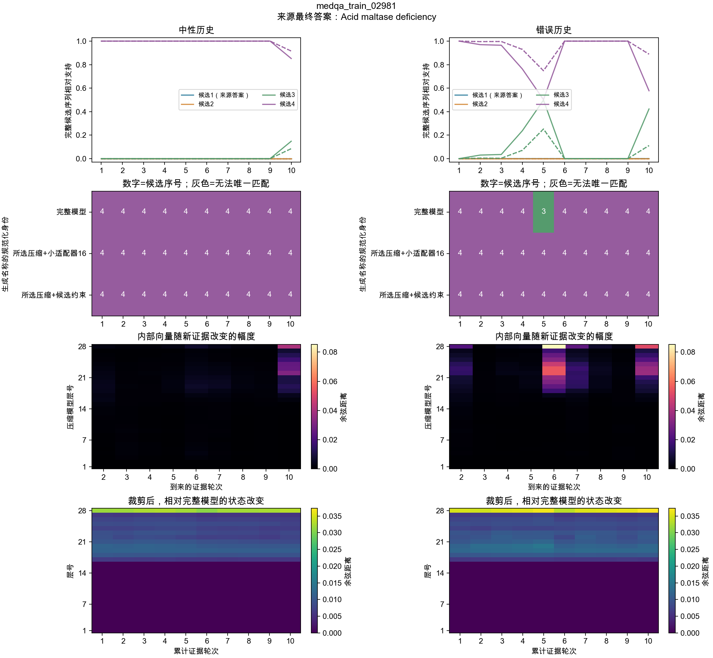

# medqa_train_02981

来源：MedQA。最终来源答案：**Acid maltase deficiency**。错误历史预设：Familial hypertrophic cardiomyopathy。

候选：1. Acid maltase deficiency；2. Clostridium tetani infection；3. Familial hypertrophic cardiomyopathy；4. Spinal muscular atrophy type I disease

实际诊断色块按统一表面写法后的候选身份绘制；逐字输出保留在下表与原文件。上图颜色按候选序号，实线=完整模型、虚线=压缩适配器、点线=第三个冻结方法。序列支持是四个完整字符串归一化后的模型分数，不是临床概率；遇到候选约束模型，则为受约束分布。内部距离只量化表示变化幅度，不能单独说明正朝哪个疾病变化；疾病方向以实际生成和完整候选支持观察。

| 轮次 | 新增事实（保留来源原文） |
|---|---|
| 1 | A newborn infant presents with severe weakness. |
| 2 | He was born to a G1P1 mother at 40 weeks gestation with the pregnancy attended by a midwife. |
| 3 | The mother's past medical history is unremarkable. |
| 4 | She took a prenatal vitamin and folic acid throughout the pregnancy. |
| 5 | Since birth, the child has had trouble breastfeeding despite proper counseling. |
| 6 | He also has had poor muscle tone and a weak cry. |
| 7 | His temperature is 99.5°F (37.5°C), blood pressure is 57/38 mmHg, pulse is 150/min, respirations are 37/min, and oxygen saturation is 96% on room air. |
| 8 | Physical exam reveals poor muscle tone. |
| 9 | The patient's sucking reflex is weak, and an enlarged tongue is noted. |
| 10 | An ultrasound is performed, and is notable for hypertrophy of the myocardium. |

## 中性历史

| 轮次 | 方法 | 实际诊断 | 最终来源答案支持 | 错误历史诊断支持 |
|---|---|---|---:|---:|
| 1 | 完整模型 | Spinal muscular atrophy type I disease | 0.000 | 0.000 |
| 1 | 所选压缩+小适配器16 | Spinal muscular atrophy type I disease | 0.000 | 0.000 |
| 1 | 所选压缩+候选约束 | Spinal muscular atrophy type I disease | 0.000 | 0.000 |
| 2 | 完整模型 | Spinal muscular atrophy type I disease | 0.000 | 0.000 |
| 2 | 所选压缩+小适配器16 | Spinal muscular atrophy type I disease | 0.000 | 0.000 |
| 2 | 所选压缩+候选约束 | Spinal muscular atrophy type I disease | 0.000 | 0.000 |
| 3 | 完整模型 | Spinal muscular atrophy type I disease | 0.000 | 0.000 |
| 3 | 所选压缩+小适配器16 | Spinal muscular atrophy type I disease | 0.000 | 0.000 |
| 3 | 所选压缩+候选约束 | Spinal muscular atrophy type I disease | 0.000 | 0.000 |
| 4 | 完整模型 | Spinal muscular atrophy type I disease | 0.000 | 0.000 |
| 4 | 所选压缩+小适配器16 | Spinal muscular atrophy type I disease | 0.000 | 0.000 |
| 4 | 所选压缩+候选约束 | Spinal muscular atrophy type I disease | 0.000 | 0.000 |
| 5 | 完整模型 | Spinal muscular atrophy type I disease | 0.000 | 0.000 |
| 5 | 所选压缩+小适配器16 | Spinal muscular atrophy type I disease | 0.000 | 0.000 |
| 5 | 所选压缩+候选约束 | Spinal muscular atrophy type I disease | 0.000 | 0.000 |
| 6 | 完整模型 | Spinal muscular atrophy type I disease | 0.000 | 0.000 |
| 6 | 所选压缩+小适配器16 | Spinal muscular atrophy type I disease | 0.000 | 0.000 |
| 6 | 所选压缩+候选约束 | Spinal muscular atrophy type I disease | 0.000 | 0.000 |
| 7 | 完整模型 | Spinal muscular atrophy type I disease | 0.000 | 0.000 |
| 7 | 所选压缩+小适配器16 | Spinal muscular atrophy type I disease | 0.000 | 0.000 |
| 7 | 所选压缩+候选约束 | Spinal muscular atrophy type I disease | 0.000 | 0.000 |
| 8 | 完整模型 | Spinal muscular atrophy type I disease | 0.000 | 0.000 |
| 8 | 所选压缩+小适配器16 | Spinal muscular atrophy type I disease | 0.000 | 0.000 |
| 8 | 所选压缩+候选约束 | Spinal muscular atrophy type I disease | 0.000 | 0.000 |
| 9 | 完整模型 | Spinal muscular atrophy type I disease | 0.000 | 0.000 |
| 9 | 所选压缩+小适配器16 | Spinal muscular atrophy type I disease | 0.000 | 0.000 |
| 9 | 所选压缩+候选约束 | Spinal muscular atrophy type I disease | 0.000 | 0.000 |
| 10 | 完整模型 | Spinal muscular atrophy type I disease | 0.000 | 0.148 |
| 10 | 所选压缩+小适配器16 | Spinal muscular atrophy type I disease | 0.000 | 0.085 |
| 10 | 所选压缩+候选约束 | Spinal muscular atrophy type I disease | 0.000 | 0.085 |

## 错误历史

| 轮次 | 方法 | 实际诊断 | 最终来源答案支持 | 错误历史诊断支持 |
|---|---|---|---:|---:|
| 1 | 完整模型 | Spinal muscular atrophy type I disease | 0.000 | 0.000 |
| 1 | 所选压缩+小适配器16 | Spinal muscular atrophy type I disease | 0.000 | 0.000 |
| 1 | 所选压缩+候选约束 | Spinal muscular atrophy type I disease | 0.000 | 0.000 |
| 2 | 完整模型 | Spinal muscular atrophy type I disease | 0.000 | 0.030 |
| 2 | 所选压缩+小适配器16 | Spinal muscular atrophy type I disease | 0.000 | 0.005 |
| 2 | 所选压缩+候选约束 | Spinal muscular atrophy type I disease | 0.000 | 0.004 |
| 3 | 完整模型 | Spinal muscular atrophy type I disease | 0.000 | 0.035 |
| 3 | 所选压缩+小适配器16 | Spinal muscular atrophy type I disease | 0.000 | 0.003 |
| 3 | 所选压缩+候选约束 | Spinal muscular atrophy type I disease | 0.000 | 0.003 |
| 4 | 完整模型 | Spinal muscular atrophy type I disease | 0.000 | 0.237 |
| 4 | 所选压缩+小适配器16 | Spinal muscular atrophy type I disease | 0.000 | 0.071 |
| 4 | 所选压缩+候选约束 | Spinal muscular atrophy type I disease | 0.000 | 0.070 |
| 5 | 完整模型 | Familial hypertrophic cardiomyopathy | 0.000 | 0.498 |
| 5 | 所选压缩+小适配器16 | Spinal muscular atrophy type I disease | 0.000 | 0.252 |
| 5 | 所选压缩+候选约束 | Spinal muscular atrophy type I disease | 0.000 | 0.251 |
| 6 | 完整模型 | Spinal muscular atrophy type I disease | 0.000 | 0.000 |
| 6 | 所选压缩+小适配器16 | Spinal muscular atrophy type I disease | 0.000 | 0.000 |
| 6 | 所选压缩+候选约束 | Spinal muscular atrophy type I disease | 0.000 | 0.000 |
| 7 | 完整模型 | Spinal muscular atrophy type I disease | 0.000 | 0.000 |
| 7 | 所选压缩+小适配器16 | Spinal muscular atrophy type I disease | 0.000 | 0.000 |
| 7 | 所选压缩+候选约束 | Spinal muscular atrophy type I disease | 0.000 | 0.000 |
| 8 | 完整模型 | Spinal muscular atrophy type I disease | 0.000 | 0.000 |
| 8 | 所选压缩+小适配器16 | Spinal muscular atrophy type I disease | 0.000 | 0.000 |
| 8 | 所选压缩+候选约束 | Spinal muscular atrophy type I disease | 0.000 | 0.000 |
| 9 | 完整模型 | Spinal muscular atrophy type I disease | 0.000 | 0.000 |
| 9 | 所选压缩+小适配器16 | Spinal muscular atrophy type I disease | 0.000 | 0.000 |
| 9 | 所选压缩+候选约束 | Spinal muscular atrophy type I disease | 0.000 | 0.000 |
| 10 | 完整模型 | Spinal muscular atrophy type I disease | 0.000 | 0.422 |
| 10 | 所选压缩+小适配器16 | Spinal muscular atrophy type I disease | 0.000 | 0.112 |
| 10 | 所选压缩+候选约束 | Spinal muscular atrophy type I disease | 0.000 | 0.110 |

原始逐轮生成、各层2048维状态和适配器前后向量见[runs轨迹目录](../../../runs/structural_v2/trajectories)。中间前缀没有独立诊断真值；“匹配来源答案”只描述是否提前到达最终答案。
