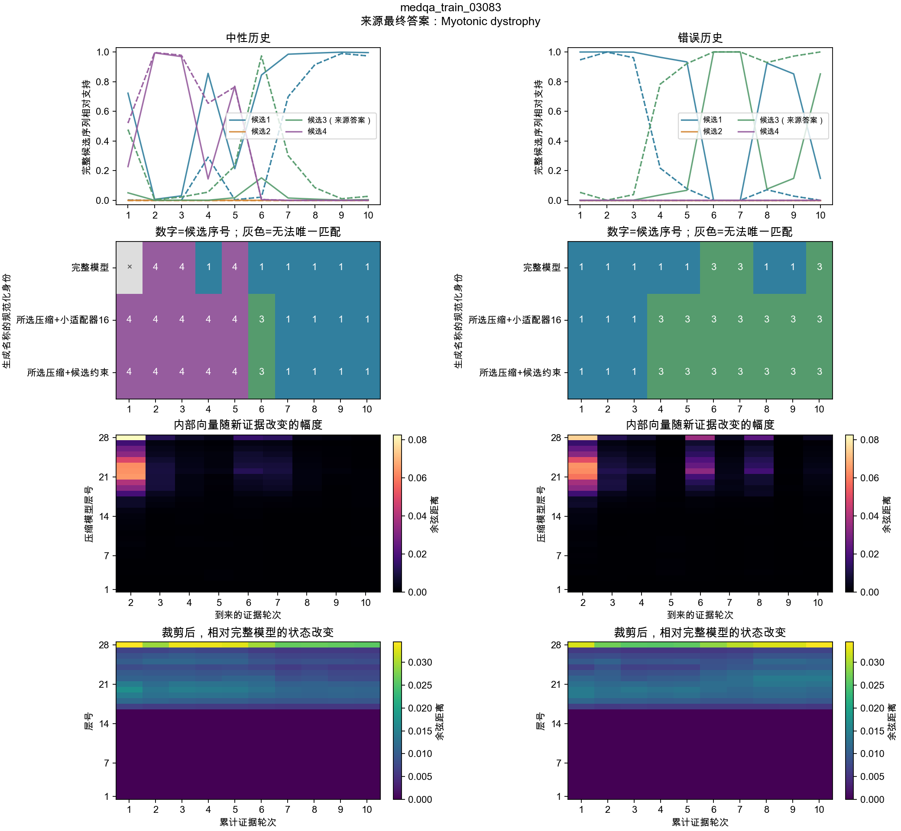

# medqa_train_03083

来源：MedQA。最终来源答案：**Myotonic dystrophy**。错误历史预设：Spinal muscular atrophy。

候选：1. Spinal muscular atrophy；2. McArdle disease；3. Myotonic dystrophy；4. Juvenile dermatomyositis

实际诊断色块按统一表面写法后的候选身份绘制；逐字输出保留在下表与原文件。上图颜色按候选序号，实线=完整模型、虚线=压缩适配器、点线=第三个冻结方法。序列支持是四个完整字符串归一化后的模型分数，不是临床概率；遇到候选约束模型，则为受约束分布。内部距离只量化表示变化幅度，不能单独说明正朝哪个疾病变化；疾病方向以实际生成和完整候选支持观察。

| 轮次 | 新增事实（保留来源原文） |
|---|---|
| 1 | A 9-year-old boy is brought to the physician for a well-child examination. |
| 2 | His mother says his teachers report him being easily distracted, lagging behind his classmates in most of the subjects, and frequently falling asleep during class. |
| 3 | She says that her son has complained of leg pain on multiple occasions. |
| 4 | He is at the 45th percentile for height and 35th percentile for weight. |
| 5 | Vital signs are within normal limits. |
| 6 | Examination shows ptosis and a high-arched palate. |
| 7 | Muscle strength is decreased in the face and hands. |
| 8 | Muscle strength of the quadriceps and hamstrings is normal. |
| 9 | Sensation is intact. |
| 10 | Percussion of the thenar eminence causes the thumb to abduct and then relax slowly. |

## 中性历史

| 轮次 | 方法 | 实际诊断 | 最终来源答案支持 | 错误历史诊断支持 |
|---|---|---|---:|---:|
| 1 | 完整模型 | Undetermined | 0.051 | 0.722 |
| 1 | 所选压缩+小适配器16 | Juvenile dermatomyositis | 0.477 | 0.002 |
| 1 | 所选压缩+候选约束 | Juvenile dermatomyositis | 0.475 | 0.002 |
| 2 | 完整模型 | Juvenile dermatomyositis | 0.000 | 0.006 |
| 2 | 所选压缩+小适配器16 | Juvenile dermatomyositis | 0.004 | 0.000 |
| 2 | 所选压缩+候选约束 | Juvenile dermatomyositis | 0.004 | 0.000 |
| 3 | 完整模型 | Juvenile dermatomyositis | 0.001 | 0.030 |
| 3 | 所选压缩+小适配器16 | Juvenile dermatomyositis | 0.022 | 0.000 |
| 3 | 所选压缩+候选约束 | Juvenile dermatomyositis | 0.022 | 0.000 |
| 4 | 完整模型 | Spinal muscular atrophy | 0.001 | 0.855 |
| 4 | 所选压缩+小适配器16 | Juvenile dermatomyositis | 0.055 | 0.290 |
| 4 | 所选压缩+候选约束 | Juvenile dermatomyositis | 0.055 | 0.290 |
| 5 | 完整模型 | Juvenile dermatomyositis | 0.018 | 0.214 |
| 5 | 所选压缩+小适配器16 | Juvenile dermatomyositis | 0.232 | 0.004 |
| 5 | 所选压缩+候选约束 | Juvenile dermatomyositis | 0.233 | 0.004 |
| 6 | 完整模型 | Spinal muscular atrophy | 0.151 | 0.844 |
| 6 | 所选压缩+小适配器16 | Myotonic dystrophy | 0.973 | 0.022 |
| 6 | 所选压缩+候选约束 | Myotonic dystrophy | 0.973 | 0.021 |
| 7 | 完整模型 | Spinal muscular atrophy | 0.015 | 0.985 |
| 7 | 所选压缩+小适配器16 | Spinal muscular atrophy | 0.301 | 0.698 |
| 7 | 所选压缩+候选约束 | Spinal muscular atrophy | 0.301 | 0.699 |
| 8 | 完整模型 | Spinal muscular atrophy | 0.008 | 0.992 |
| 8 | 所选压缩+小适配器16 | Spinal muscular atrophy | 0.086 | 0.914 |
| 8 | 所选压缩+候选约束 | Spinal muscular atrophy | 0.085 | 0.915 |
| 9 | 完整模型 | Spinal muscular atrophy | 0.002 | 0.998 |
| 9 | 所选压缩+小适配器16 | Spinal muscular atrophy | 0.011 | 0.989 |
| 9 | 所选压缩+候选约束 | Spinal muscular atrophy | 0.011 | 0.989 |
| 10 | 完整模型 | Spinal muscular atrophy | 0.005 | 0.995 |
| 10 | 所选压缩+小适配器16 | Spinal muscular atrophy | 0.027 | 0.973 |
| 10 | 所选压缩+候选约束 | Spinal muscular atrophy | 0.027 | 0.973 |

## 错误历史

| 轮次 | 方法 | 实际诊断 | 最终来源答案支持 | 错误历史诊断支持 |
|---|---|---|---:|---:|
| 1 | 完整模型 | Spinal muscular atrophy | 0.001 | 0.999 |
| 1 | 所选压缩+小适配器16 | Spinal muscular atrophy | 0.053 | 0.947 |
| 1 | 所选压缩+候选约束 | Spinal muscular atrophy | 0.053 | 0.947 |
| 2 | 完整模型 | Spinal muscular atrophy | 0.000 | 1.000 |
| 2 | 所选压缩+小适配器16 | Spinal muscular atrophy | 0.001 | 0.999 |
| 2 | 所选压缩+候选约束 | Spinal muscular atrophy | 0.001 | 0.999 |
| 3 | 完整模型 | Spinal muscular atrophy | 0.001 | 0.999 |
| 3 | 所选压缩+小适配器16 | Spinal muscular atrophy | 0.038 | 0.961 |
| 3 | 所选压缩+候选约束 | Spinal muscular atrophy | 0.038 | 0.961 |
| 4 | 完整模型 | Spinal muscular atrophy | 0.036 | 0.964 |
| 4 | 所选压缩+小适配器16 | Myotonic dystrophy | 0.783 | 0.217 |
| 4 | 所选压缩+候选约束 | Myotonic dystrophy | 0.783 | 0.217 |
| 5 | 完整模型 | Spinal muscular atrophy | 0.068 | 0.932 |
| 5 | 所选压缩+小适配器16 | Myotonic dystrophy | 0.922 | 0.078 |
| 5 | 所选压缩+候选约束 | Myotonic dystrophy | 0.922 | 0.078 |
| 6 | 完整模型 | Myotonic dystrophy | 1.000 | 0.000 |
| 6 | 所选压缩+小适配器16 | Myotonic dystrophy | 1.000 | 0.000 |
| 6 | 所选压缩+候选约束 | Myotonic dystrophy | 1.000 | 0.000 |
| 7 | 完整模型 | Myotonic dystrophy | 1.000 | 0.000 |
| 7 | 所选压缩+小适配器16 | Myotonic dystrophy | 1.000 | 0.000 |
| 7 | 所选压缩+候选约束 | Myotonic dystrophy | 1.000 | 0.000 |
| 8 | 完整模型 | Spinal muscular atrophy | 0.076 | 0.924 |
| 8 | 所选压缩+小适配器16 | Myotonic dystrophy | 0.929 | 0.071 |
| 8 | 所选压缩+候选约束 | Myotonic dystrophy | 0.928 | 0.072 |
| 9 | 完整模型 | Spinal muscular atrophy | 0.148 | 0.852 |
| 9 | 所选压缩+小适配器16 | Myotonic dystrophy | 0.972 | 0.028 |
| 9 | 所选压缩+候选约束 | Myotonic dystrophy | 0.972 | 0.028 |
| 10 | 完整模型 | Myotonic dystrophy | 0.852 | 0.148 |
| 10 | 所选压缩+小适配器16 | Myotonic dystrophy | 1.000 | 0.000 |
| 10 | 所选压缩+候选约束 | Myotonic dystrophy | 1.000 | 0.000 |

原始逐轮生成、各层2048维状态和适配器前后向量见[runs轨迹目录](../../../runs/structural_v2/trajectories)。中间前缀没有独立诊断真值；“匹配来源答案”只描述是否提前到达最终答案。
