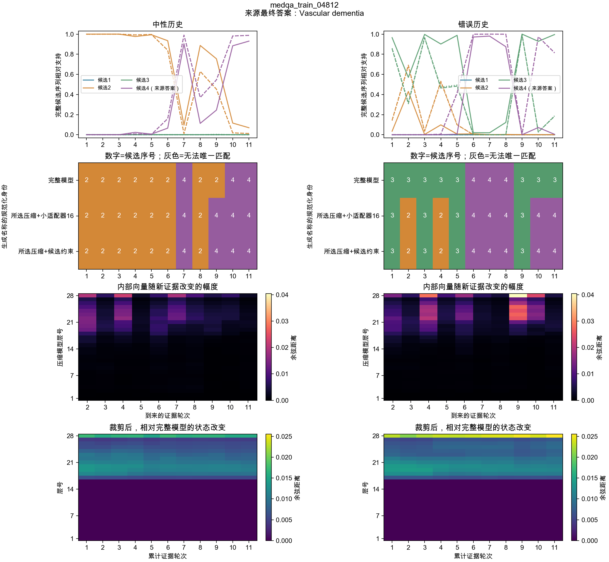

# medqa_train_04812

来源：MedQA。最终来源答案：**Vascular dementia**。错误历史预设：Lewy body dementia。

候选：1. Normal aging；2. Alzheimer's dementia；3. Lewy body dementia；4. Vascular dementia

实际诊断色块按统一表面写法后的候选身份绘制；逐字输出保留在下表与原文件。上图颜色按候选序号，实线=完整模型、虚线=压缩适配器、点线=第三个冻结方法。序列支持是四个完整字符串归一化后的模型分数，不是临床概率；遇到候选约束模型，则为受约束分布。内部距离只量化表示变化幅度，不能单独说明正朝哪个疾病变化；疾病方向以实际生成和完整候选支持观察。

| 轮次 | 新增事实（保留来源原文） |
|---|---|
| 1 | A 66-year-old man is brought into the emergency department by his daughter for a change in behavior. |
| 2 | Yesterday the patient seemed more confused than usual and was asking the same questions repetitively. |
| 3 | His symptoms have not improved over the past 24 hours, thus the decision to bring him in today. |
| 4 | Last year, the patient was almost completely independent but he then suffered a "series of falls," after which his ability to care for himself declined. |
| 5 | After this episode he was no longer able to cook for himself or pay his bills but otherwise had been fine up until this episode. |
| 6 | The patient has a past medical history of myocardial infarction, hypertension, depression, diabetes mellitus type II, constipation, diverticulitis, and peripheral neuropathy. |
| 7 | His current medications include metformin, insulin, lisinopril, hydrochlorothiazide, sodium docusate, atorvastatin, metoprolol, fluoxetine, and gabapentin. |
| 8 | On exam you note a confused man who is poorly kept. |
| 9 | He has bruises over his legs and his gait seems unstable. |
| 10 | He is alert to person and place, and answers some questions inappropriately. |
| 11 | The patient's pulse is 90/minute and his blood pressure is 170/100 mmHg. |

## 中性历史

| 轮次 | 方法 | 实际诊断 | 最终来源答案支持 | 错误历史诊断支持 |
|---|---|---|---:|---:|
| 1 | 完整模型 | Alzheimer's dementia | 0.000 | 0.000 |
| 1 | 所选压缩+小适配器16 | Alzheimer's dementia | 0.000 | 0.000 |
| 1 | 所选压缩+候选约束 | Alzheimer's dementia | 0.000 | 0.001 |
| 2 | 完整模型 | Alzheimer's dementia | 0.000 | 0.000 |
| 2 | 所选压缩+小适配器16 | Alzheimer's dementia | 0.000 | 0.000 |
| 2 | 所选压缩+候选约束 | Alzheimer's dementia | 0.000 | 0.000 |
| 3 | 完整模型 | Alzheimer's dementia | 0.000 | 0.000 |
| 3 | 所选压缩+小适配器16 | Alzheimer's dementia | 0.000 | 0.000 |
| 3 | 所选压缩+候选约束 | Alzheimer's dementia | 0.000 | 0.000 |
| 4 | 完整模型 | Alzheimer's dementia | 0.024 | 0.000 |
| 4 | 所选压缩+小适配器16 | Alzheimer's dementia | 0.008 | 0.000 |
| 4 | 所选压缩+候选约束 | Alzheimer's dementia | 0.008 | 0.000 |
| 5 | 完整模型 | Alzheimer's dementia | 0.006 | 0.000 |
| 5 | 所选压缩+小适配器16 | Alzheimer's dementia | 0.003 | 0.000 |
| 5 | 所选压缩+候选约束 | Alzheimer's dementia | 0.003 | 0.000 |
| 6 | 完整模型 | Alzheimer's dementia | 0.066 | 0.000 |
| 6 | 所选压缩+小适配器16 | Alzheimer's dementia | 0.160 | 0.000 |
| 6 | 所选压缩+候选约束 | Alzheimer's dementia | 0.160 | 0.000 |
| 7 | 完整模型 | Vascular dementia | 0.905 | 0.000 |
| 7 | 所选压缩+小适配器16 | Vascular dementia | 0.990 | 0.000 |
| 7 | 所选压缩+候选约束 | Vascular dementia | 0.990 | 0.000 |
| 8 | 完整模型 | Alzheimer's dementia | 0.113 | 0.000 |
| 8 | 所选压缩+小适配器16 | Alzheimer's dementia | 0.370 | 0.000 |
| 8 | 所选压缩+候选约束 | Alzheimer's dementia | 0.370 | 0.000 |
| 9 | 完整模型 | Alzheimer's dementia | 0.245 | 0.000 |
| 9 | 所选压缩+小适配器16 | Vascular dementia | 0.546 | 0.002 |
| 9 | 所选压缩+候选约束 | Vascular dementia | 0.544 | 0.004 |
| 10 | 完整模型 | Vascular dementia | 0.884 | 0.000 |
| 10 | 所选压缩+小适配器16 | Vascular dementia | 0.981 | 0.000 |
| 10 | 所选压缩+候选约束 | Vascular dementia | 0.981 | 0.000 |
| 11 | 完整模型 | Vascular dementia | 0.930 | 0.000 |
| 11 | 所选压缩+小适配器16 | Vascular dementia | 0.988 | 0.000 |
| 11 | 所选压缩+候选约束 | Vascular dementia | 0.987 | 0.000 |

## 错误历史

| 轮次 | 方法 | 实际诊断 | 最终来源答案支持 | 错误历史诊断支持 |
|---|---|---|---:|---:|
| 1 | 完整模型 | Lewy body dementia | 0.000 | 0.965 |
| 1 | 所选压缩+小适配器16 | Lewy body dementia | 0.000 | 0.855 |
| 1 | 所选压缩+候选约束 | Lewy body dementia | 0.000 | 0.860 |
| 2 | 完整模型 | Lewy body dementia | 0.000 | 0.570 |
| 2 | 所选压缩+小适配器16 | Alzheimer's dementia | 0.000 | 0.308 |
| 2 | 所选压缩+候选约束 | Alzheimer's dementia | 0.000 | 0.321 |
| 3 | 完整模型 | Lewy body dementia | 0.000 | 0.997 |
| 3 | 所选压缩+小适配器16 | Lewy body dementia | 0.000 | 0.965 |
| 3 | 所选压缩+候选约束 | Lewy body dementia | 0.000 | 0.967 |
| 4 | 完整模型 | Lewy body dementia | 0.000 | 0.902 |
| 4 | 所选压缩+小适配器16 | Alzheimer's dementia | 0.005 | 0.463 |
| 4 | 所选压缩+候选约束 | Alzheimer's dementia | 0.005 | 0.474 |
| 5 | 完整模型 | Lewy body dementia | 0.005 | 0.988 |
| 5 | 所选压缩+小适配器16 | Lewy body dementia | 0.418 | 0.483 |
| 5 | 所选压缩+候选约束 | Lewy body dementia | 0.409 | 0.494 |
| 6 | 完整模型 | Vascular dementia | 0.971 | 0.020 |
| 6 | 所选压缩+小适配器16 | Vascular dementia | 0.999 | 0.000 |
| 6 | 所选压缩+候选约束 | Vascular dementia | 0.999 | 0.000 |
| 7 | 完整模型 | vascular dementia | 0.980 | 0.019 |
| 7 | 所选压缩+小适配器16 | Vascular dementia | 1.000 | 0.000 |
| 7 | 所选压缩+候选约束 | Vascular dementia | 1.000 | 0.000 |
| 8 | 完整模型 | vascular dementia | 0.875 | 0.122 |
| 8 | 所选压缩+小适配器16 | Vascular dementia | 0.999 | 0.000 |
| 8 | 所选压缩+候选约束 | Vascular dementia | 0.999 | 0.000 |
| 9 | 完整模型 | Lewy body dementia | 0.000 | 1.000 |
| 9 | 所选压缩+小适配器16 | Lewy body dementia | 0.005 | 0.995 |
| 9 | 所选压缩+候选约束 | Lewy body dementia | 0.005 | 0.995 |
| 10 | 完整模型 | Lewy body dementia | 0.072 | 0.928 |
| 10 | 所选压缩+小适配器16 | Vascular dementia | 0.974 | 0.026 |
| 10 | 所选压缩+候选约束 | Vascular dementia | 0.973 | 0.027 |
| 11 | 完整模型 | Lewy body dementia | 0.004 | 0.996 |
| 11 | 所选压缩+小适配器16 | Vascular dementia | 0.816 | 0.184 |
| 11 | 所选压缩+候选约束 | Vascular dementia | 0.813 | 0.187 |

原始逐轮生成、各层2048维状态和适配器前后向量见[runs轨迹目录](../../../runs/structural_v2/trajectories)。中间前缀没有独立诊断真值；“匹配来源答案”只描述是否提前到达最终答案。
