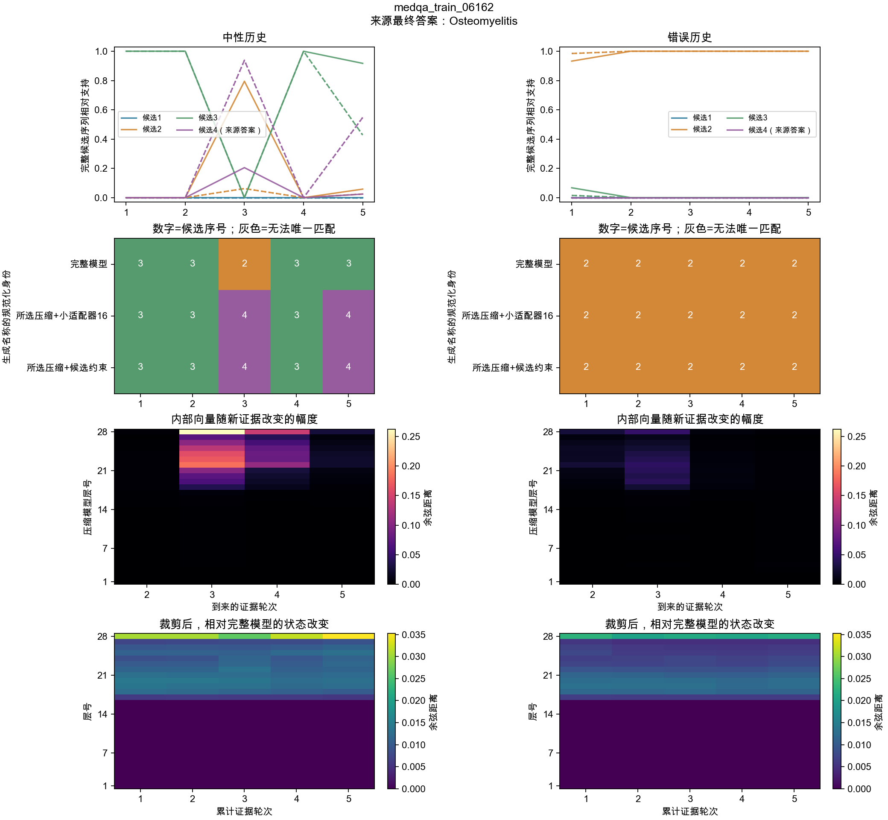

# medqa_train_06162

来源：MedQA。最终来源答案：**Osteomyelitis**。错误历史预设：Herniated nucleus pulposus。

候选：1. Degenerative spine disease；2. Herniated nucleus pulposus；3. Musculoskeletal strain；4. Osteomyelitis

实际诊断色块按统一表面写法后的候选身份绘制；逐字输出保留在下表与原文件。上图颜色按候选序号，实线=完整模型、虚线=压缩适配器、点线=第三个冻结方法。序列支持是四个完整字符串归一化后的模型分数，不是临床概率；遇到候选约束模型，则为受约束分布。内部距离只量化表示变化幅度，不能单独说明正朝哪个疾病变化；疾病方向以实际生成和完整候选支持观察。

| 轮次 | 新增事实（保留来源原文） |
|---|---|
| 1 | A 33-year-old man with a history of IV drug and alcohol abuse presents to the emergency department with back pain. |
| 2 | He states that his symptoms started 3 days ago and have been gradually worsening. |
| 3 | His temperature is 102°F (38.9°C), blood pressure is 127/68 mmHg, pulse is 120/min, respirations are 17/min, and oxygen saturation is 98% on room air. |
| 4 | Physical exam is notable for tenderness over the mid thoracic spine. |
| 5 | Laboratory values are only notable for a leukocytosis and an elevated ESR and CRP. |

## 中性历史

| 轮次 | 方法 | 实际诊断 | 最终来源答案支持 | 错误历史诊断支持 |
|---|---|---|---:|---:|
| 1 | 完整模型 | Musculoskeletal strain | 0.000 | 0.000 |
| 1 | 所选压缩+小适配器16 | Musculoskeletal strain | 0.000 | 0.000 |
| 1 | 所选压缩+候选约束 | Musculoskeletal strain | 0.000 | 0.000 |
| 2 | 完整模型 | Musculoskeletal strain | 0.000 | 0.000 |
| 2 | 所选压缩+小适配器16 | Musculoskeletal strain | 0.000 | 0.000 |
| 2 | 所选压缩+候选约束 | Musculoskeletal strain | 0.000 | 0.000 |
| 3 | 完整模型 | Herniated nucleus pulposus | 0.205 | 0.795 |
| 3 | 所选压缩+小适配器16 | Osteomyelitis | 0.938 | 0.062 |
| 3 | 所选压缩+候选约束 | Osteomyelitis | 0.938 | 0.062 |
| 4 | 完整模型 | Musculoskeletal strain | 0.000 | 0.000 |
| 4 | 所选压缩+小适配器16 | Musculoskeletal strain | 0.000 | 0.000 |
| 4 | 所选压缩+候选约束 | Musculoskeletal strain | 0.000 | 0.000 |
| 5 | 完整模型 | Musculoskeletal strain | 0.024 | 0.058 |
| 5 | 所选压缩+小适配器16 | Osteomyelitis | 0.547 | 0.025 |
| 5 | 所选压缩+候选约束 | Osteomyelitis | 0.548 | 0.025 |

## 错误历史

| 轮次 | 方法 | 实际诊断 | 最终来源答案支持 | 错误历史诊断支持 |
|---|---|---|---:|---:|
| 1 | 完整模型 | Herniated nucleus pulposus | 0.000 | 0.932 |
| 1 | 所选压缩+小适配器16 | Herniated nucleus pulposus | 0.000 | 0.984 |
| 1 | 所选压缩+候选约束 | Herniated nucleus pulposus | 0.000 | 0.985 |
| 2 | 完整模型 | Herniated nucleus pulposus | 0.000 | 1.000 |
| 2 | 所选压缩+小适配器16 | Herniated nucleus pulposus | 0.000 | 1.000 |
| 2 | 所选压缩+候选约束 | Herniated nucleus pulposus | 0.000 | 1.000 |
| 3 | 完整模型 | Herniated nucleus pulposus | 0.000 | 1.000 |
| 3 | 所选压缩+小适配器16 | Herniated nucleus pulposus | 0.000 | 1.000 |
| 3 | 所选压缩+候选约束 | Herniated nucleus pulposus | 0.000 | 1.000 |
| 4 | 完整模型 | Herniated nucleus pulposus | 0.000 | 1.000 |
| 4 | 所选压缩+小适配器16 | Herniated nucleus pulposus | 0.000 | 1.000 |
| 4 | 所选压缩+候选约束 | Herniated nucleus pulposus | 0.000 | 1.000 |
| 5 | 完整模型 | Herniated nucleus pulposus | 0.000 | 1.000 |
| 5 | 所选压缩+小适配器16 | Herniated nucleus pulposus | 0.000 | 1.000 |
| 5 | 所选压缩+候选约束 | Herniated nucleus pulposus | 0.000 | 1.000 |

原始逐轮生成、各层2048维状态和适配器前后向量见[runs轨迹目录](../../../runs/structural_v2/trajectories)。中间前缀没有独立诊断真值；“匹配来源答案”只描述是否提前到达最终答案。
