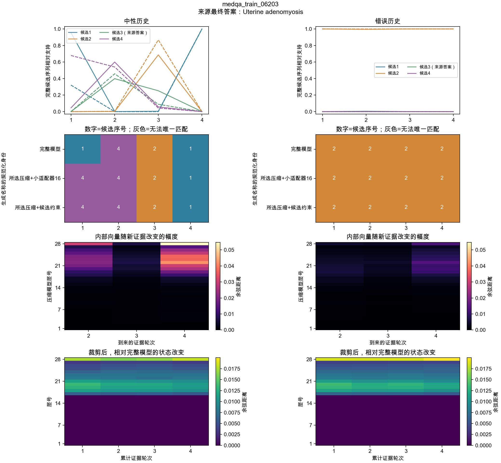

# medqa_train_06203

来源：MedQA。最终来源答案：**Uterine adenomyosis**。错误历史预设：Uterine leiomyoma。

候选：1. Endometrial carcinoma；2. Uterine leiomyoma；3. Uterine adenomyosis；4. Endometrial hyperplasia

实际诊断色块按统一表面写法后的候选身份绘制；逐字输出保留在下表与原文件。上图颜色按候选序号，实线=完整模型、虚线=压缩适配器、点线=第三个冻结方法。序列支持是四个完整字符串归一化后的模型分数，不是临床概率；遇到候选约束模型，则为受约束分布。内部距离只量化表示变化幅度，不能单独说明正朝哪个疾病变化；疾病方向以实际生成和完整候选支持观察。

| 轮次 | 新增事实（保留来源原文） |
|---|---|
| 1 | A 40-year-old woman visits your office with her pathology report after being subjected to total abdominal hysterectomy a month ago. |
| 2 | She explains that she went through this procedure after a long history of lower abdominal pain that worsened during menses and heavy menstrual bleeding. |
| 3 | She is a mother of 5 children, and they are all delivered by cesarean section. |
| 4 | The pathology gross examination report and microscopic examination report from the specimen from surgery describes an enlarged, globular uterus with invading clusters of endometrial tissue within the myometrium. |

## 中性历史

| 轮次 | 方法 | 实际诊断 | 最终来源答案支持 | 错误历史诊断支持 |
|---|---|---|---:|---:|
| 1 | 完整模型 | Endometrial carcinoma | 0.001 | 0.000 |
| 1 | 所选压缩+小适配器16 | Endometrial hyperplasia | 0.001 | 0.000 |
| 1 | 所选压缩+候选约束 | Endometrial hyperplasia | 0.001 | 0.000 |
| 2 | 完整模型 | Endometrial hyperplasia | 0.398 | 0.001 |
| 2 | 所选压缩+小适配器16 | Endometrial hyperplasia | 0.457 | 0.003 |
| 2 | 所选压缩+候选约束 | Endometrial hyperplasia | 0.458 | 0.003 |
| 3 | 完整模型 | Uterine leiomyoma | 0.252 | 0.686 |
| 3 | 所选压缩+小适配器16 | Uterine leiomyoma | 0.089 | 0.867 |
| 3 | 所选压缩+候选约束 | Uterine leiomyoma | 0.089 | 0.868 |
| 4 | 完整模型 | Endometrial carcinoma | 0.000 | 0.000 |
| 4 | 所选压缩+小适配器16 | Endometrial carcinoma | 0.000 | 0.000 |
| 4 | 所选压缩+候选约束 | Endometrial carcinoma | 0.000 | 0.000 |

## 错误历史

| 轮次 | 方法 | 实际诊断 | 最终来源答案支持 | 错误历史诊断支持 |
|---|---|---|---:|---:|
| 1 | 完整模型 | Uterine leiomyoma | 0.000 | 1.000 |
| 1 | 所选压缩+小适配器16 | Uterine leiomyoma | 0.000 | 1.000 |
| 1 | 所选压缩+候选约束 | Uterine leiomyoma | 0.000 | 1.000 |
| 2 | 完整模型 | Uterine leiomyoma | 0.005 | 0.995 |
| 2 | 所选压缩+小适配器16 | Uterine leiomyoma | 0.001 | 0.999 |
| 2 | 所选压缩+候选约束 | Uterine leiomyoma | 0.001 | 0.999 |
| 3 | 完整模型 | Uterine leiomyoma | 0.000 | 1.000 |
| 3 | 所选压缩+小适配器16 | Uterine leiomyoma | 0.000 | 1.000 |
| 3 | 所选压缩+候选约束 | Uterine leiomyoma | 0.000 | 1.000 |
| 4 | 完整模型 | Uterine leiomyoma | 0.000 | 1.000 |
| 4 | 所选压缩+小适配器16 | Uterine leiomyoma | 0.000 | 1.000 |
| 4 | 所选压缩+候选约束 | Uterine leiomyoma | 0.000 | 1.000 |

原始逐轮生成、各层2048维状态和适配器前后向量见[runs轨迹目录](../../../runs/structural_v2/trajectories)。中间前缀没有独立诊断真值；“匹配来源答案”只描述是否提前到达最终答案。
