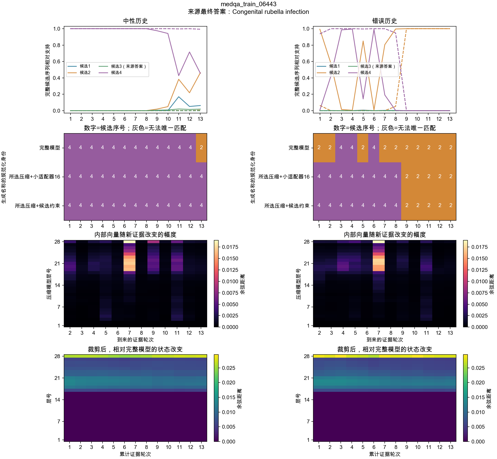

# medqa_train_06443

来源：MedQA。最终来源答案：**Congenital rubella infection**。错误历史预设：Congenital syphilis。

候选：1. Congenital parvovirus B19 infection；2. Congenital syphilis；3. Congenital rubella infection；4. Congenital CMV infection

实际诊断色块按统一表面写法后的候选身份绘制；逐字输出保留在下表与原文件。上图颜色按候选序号，实线=完整模型、虚线=压缩适配器、点线=第三个冻结方法。序列支持是四个完整字符串归一化后的模型分数，不是临床概率；遇到候选约束模型，则为受约束分布。内部距离只量化表示变化幅度，不能单独说明正朝哪个疾病变化；疾病方向以实际生成和完整候选支持观察。

| 轮次 | 新增事实（保留来源原文） |
|---|---|
| 1 | A 3175-g (7-lb) female newborn is delivered at 37 weeks to a 26-year-old primigravid woman. |
| 2 | Apgar scores are 8 and 9 at 1 and 5 minutes, respectively. |
| 3 | The pregnancy had been uncomplicated. |
| 4 | The mother had no prenatal care. |
| 5 | She immigrated to the US from Brazil 2 years ago. |
| 6 | Immunization records are not available. |
| 7 | One day after delivery, the newborn's temperature is 37.5°C (99.5°F), pulse is 182/min, respirations are 60/min, and blood pressure is 82/60 mm Hg. |
| 8 | The lungs are clear to auscultation. |
| 9 | Cardiac examination shows a continuous heart murmur. |
| 10 | The abdomen is soft and nontender. |
| 11 | There are several discolored areas on the skin that are non-blanchable upon pressure application. |
| 12 | Slit lamp examination shows cloudy lenses in both eyes. |
| 13 | The newborn does not pass her auditory screening tests. |

## 中性历史

| 轮次 | 方法 | 实际诊断 | 最终来源答案支持 | 错误历史诊断支持 |
|---|---|---|---:|---:|
| 1 | 完整模型 | Congenital CMV infection | 0.000 | 0.000 |
| 1 | 所选压缩+小适配器16 | Congenital CMV infection | 0.000 | 0.000 |
| 1 | 所选压缩+候选约束 | Congenital CMV infection | 0.000 | 0.000 |
| 2 | 完整模型 | Congenital CMV infection | 0.000 | 0.000 |
| 2 | 所选压缩+小适配器16 | Congenital CMV infection | 0.000 | 0.000 |
| 2 | 所选压缩+候选约束 | Congenital CMV infection | 0.000 | 0.000 |
| 3 | 完整模型 | Congenital CMV infection | 0.000 | 0.000 |
| 3 | 所选压缩+小适配器16 | Congenital CMV infection | 0.000 | 0.000 |
| 3 | 所选压缩+候选约束 | Congenital CMV infection | 0.000 | 0.000 |
| 4 | 完整模型 | Congenital CMV infection | 0.000 | 0.000 |
| 4 | 所选压缩+小适配器16 | Congenital CMV infection | 0.000 | 0.000 |
| 4 | 所选压缩+候选约束 | Congenital CMV infection | 0.000 | 0.000 |
| 5 | 完整模型 | Congenital CMV infection | 0.000 | 0.000 |
| 5 | 所选压缩+小适配器16 | Congenital CMV infection | 0.000 | 0.000 |
| 5 | 所选压缩+候选约束 | Congenital CMV infection | 0.000 | 0.000 |
| 6 | 完整模型 | Congenital CMV infection | 0.000 | 0.000 |
| 6 | 所选压缩+小适配器16 | Congenital CMV infection | 0.000 | 0.000 |
| 6 | 所选压缩+候选约束 | Congenital CMV infection | 0.000 | 0.000 |
| 7 | 完整模型 | Congenital CMV infection | 0.000 | 0.000 |
| 7 | 所选压缩+小适配器16 | Congenital CMV infection | 0.000 | 0.000 |
| 7 | 所选压缩+候选约束 | Congenital CMV infection | 0.000 | 0.000 |
| 8 | 完整模型 | Congenital CMV infection | 0.000 | 0.000 |
| 8 | 所选压缩+小适配器16 | Congenital CMV infection | 0.000 | 0.000 |
| 8 | 所选压缩+候选约束 | Congenital CMV infection | 0.000 | 0.000 |
| 9 | 完整模型 | Congenital CMV infection | 0.006 | 0.019 |
| 9 | 所选压缩+小适配器16 | Congenital CMV infection | 0.000 | 0.000 |
| 9 | 所选压缩+候选约束 | Congenital CMV infection | 0.000 | 0.000 |
| 10 | 完整模型 | Congenital CMV infection | 0.009 | 0.049 |
| 10 | 所选压缩+小适配器16 | Congenital CMV infection | 0.000 | 0.000 |
| 10 | 所选压缩+候选约束 | Congenital CMV infection | 0.000 | 0.000 |
| 11 | 完整模型 | Congenital CMV infection | 0.021 | 0.383 |
| 11 | 所选压缩+小适配器16 | Congenital CMV infection | 0.000 | 0.003 |
| 11 | 所选压缩+候选约束 | Congenital CMV infection | 0.000 | 0.003 |
| 12 | 完整模型 | Congenital CMV infection | 0.015 | 0.218 |
| 12 | 所选压缩+小适配器16 | Congenital CMV infection | 0.000 | 0.001 |
| 12 | 所选压缩+候选约束 | Congenital CMV infection | 0.000 | 0.001 |
| 13 | 完整模型 | Congenital syphilis | 0.019 | 0.463 |
| 13 | 所选压缩+小适配器16 | Congenital CMV infection | 0.000 | 0.007 |
| 13 | 所选压缩+候选约束 | Congenital CMV infection | 0.000 | 0.007 |

## 错误历史

| 轮次 | 方法 | 实际诊断 | 最终来源答案支持 | 错误历史诊断支持 |
|---|---|---|---:|---:|
| 1 | 完整模型 | Congenital syphilis | 0.000 | 0.993 |
| 1 | 所选压缩+小适配器16 | Congenital CMV infection | 0.000 | 0.064 |
| 1 | 所选压缩+候选约束 | Congenital CMV infection | 0.000 | 0.064 |
| 2 | 完整模型 | Congenital syphilis | 0.000 | 0.584 |
| 2 | 所选压缩+小适配器16 | Congenital CMV infection | 0.000 | 0.001 |
| 2 | 所选压缩+候选约束 | Congenital CMV infection | 0.000 | 0.001 |
| 3 | 完整模型 | Congenital CMV infection | 0.000 | 0.015 |
| 3 | 所选压缩+小适配器16 | Congenital CMV infection | 0.000 | 0.000 |
| 3 | 所选压缩+候选约束 | Congenital CMV infection | 0.000 | 0.000 |
| 4 | 完整模型 | Congenital CMV infection | 0.000 | 0.005 |
| 4 | 所选压缩+小适配器16 | Congenital CMV infection | 0.000 | 0.000 |
| 4 | 所选压缩+候选约束 | Congenital CMV infection | 0.000 | 0.000 |
| 5 | 完整模型 | Congenital syphilis | 0.000 | 0.850 |
| 5 | 所选压缩+小适配器16 | Congenital CMV infection | 0.000 | 0.004 |
| 5 | 所选压缩+候选约束 | Congenital CMV infection | 0.000 | 0.004 |
| 6 | 完整模型 | Congenital CMV infection | 0.000 | 0.007 |
| 6 | 所选压缩+小适配器16 | Congenital CMV infection | 0.000 | 0.000 |
| 6 | 所选压缩+候选约束 | Congenital CMV infection | 0.000 | 0.000 |
| 7 | 完整模型 | Congenital syphilis | 0.001 | 0.805 |
| 7 | 所选压缩+小适配器16 | Congenital CMV infection | 0.000 | 0.000 |
| 7 | 所选压缩+候选约束 | Congenital CMV infection | 0.000 | 0.000 |
| 8 | 完整模型 | Congenital syphilis | 0.000 | 0.996 |
| 8 | 所选压缩+小适配器16 | Congenital CMV infection | 0.000 | 0.052 |
| 8 | 所选压缩+候选约束 | Congenital CMV infection | 0.000 | 0.052 |
| 9 | 完整模型 | Congenital syphilis | 0.000 | 1.000 |
| 9 | 所选压缩+小适配器16 | Congenital syphilis | 0.000 | 0.999 |
| 9 | 所选压缩+候选约束 | Congenital syphilis | 0.000 | 0.999 |
| 10 | 完整模型 | Congenital syphilis | 0.000 | 1.000 |
| 10 | 所选压缩+小适配器16 | Congenital syphilis | 0.000 | 1.000 |
| 10 | 所选压缩+候选约束 | Congenital syphilis | 0.000 | 1.000 |
| 11 | 完整模型 | Congenital syphilis | 0.000 | 1.000 |
| 11 | 所选压缩+小适配器16 | Congenital syphilis | 0.000 | 1.000 |
| 11 | 所选压缩+候选约束 | Congenital syphilis | 0.000 | 1.000 |
| 12 | 完整模型 | Congenital syphilis | 0.000 | 1.000 |
| 12 | 所选压缩+小适配器16 | Congenital syphilis | 0.000 | 1.000 |
| 12 | 所选压缩+候选约束 | Congenital syphilis | 0.000 | 1.000 |
| 13 | 完整模型 | Congenital syphilis | 0.000 | 1.000 |
| 13 | 所选压缩+小适配器16 | Congenital syphilis | 0.000 | 1.000 |
| 13 | 所选压缩+候选约束 | Congenital syphilis | 0.000 | 1.000 |

原始逐轮生成、各层2048维状态和适配器前后向量见[runs轨迹目录](../../../runs/structural_v2/trajectories)。中间前缀没有独立诊断真值；“匹配来源答案”只描述是否提前到达最终答案。
