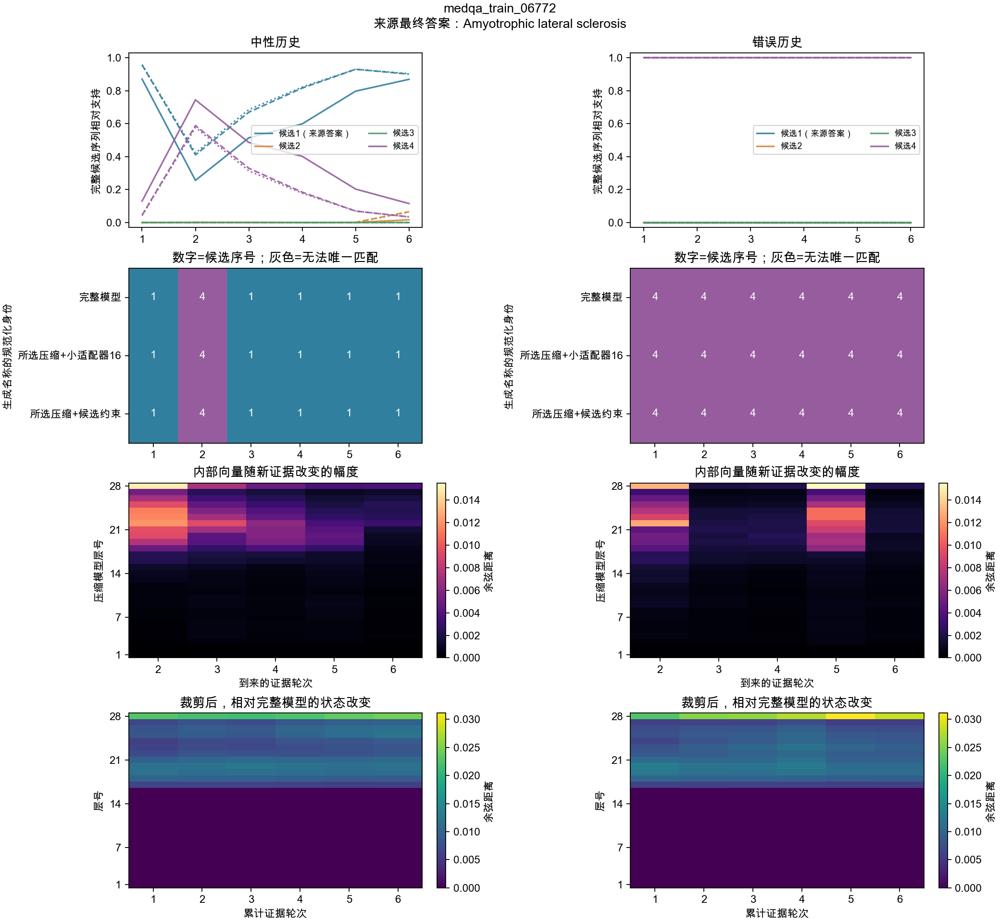

# medqa_train_06772

来源：MedQA。最终来源答案：**Amyotrophic lateral sclerosis**。错误历史预设：Spinal muscular atrophy。

候选：1. Amyotrophic lateral sclerosis；2. Guillain-Barré syndrome；3. Myasthenia gravis；4. Spinal muscular atrophy

实际诊断色块按统一表面写法后的候选身份绘制；逐字输出保留在下表与原文件。上图颜色按候选序号，实线=完整模型、虚线=压缩适配器、点线=第三个冻结方法。序列支持是四个完整字符串归一化后的模型分数，不是临床概率；遇到候选约束模型，则为受约束分布。内部距离只量化表示变化幅度，不能单独说明正朝哪个疾病变化；疾病方向以实际生成和完整候选支持观察。

| 轮次 | 新增事实（保留来源原文） |
|---|---|
| 1 | A 62-year-old woman is brought to the physician because of 6 months of progressive weakness in her arms and legs. |
| 2 | During this time, she has also had difficulty swallowing and holding her head up. |
| 3 | Examination shows pooling of oral secretions. |
| 4 | Muscle strength and tone are decreased in the upper extremities. |
| 5 | Deep tendon reflexes are 1+ in the right upper and lower extremities, 3+ in the left upper extremity, and 4+ in the left lower extremity. |
| 6 | Sensation to light touch, pinprick, and vibration are intact. |

## 中性历史

| 轮次 | 方法 | 实际诊断 | 最终来源答案支持 | 错误历史诊断支持 |
|---|---|---|---:|---:|
| 1 | 完整模型 | Amyotrophic lateral sclerosis | 0.870 | 0.130 |
| 1 | 所选压缩+小适配器16 | Amyotrophic lateral sclerosis | 0.956 | 0.044 |
| 1 | 所选压缩+候选约束 | Amyotrophic lateral sclerosis | 0.958 | 0.042 |
| 2 | 完整模型 | Spinal muscular atrophy | 0.256 | 0.744 |
| 2 | 所选压缩+小适配器16 | Spinal muscular atrophy | 0.411 | 0.588 |
| 2 | 所选压缩+候选约束 | Spinal muscular atrophy | 0.422 | 0.577 |
| 3 | 完整模型 | Amyotrophic lateral sclerosis | 0.514 | 0.486 |
| 3 | 所选压缩+小适配器16 | Amyotrophic lateral sclerosis | 0.669 | 0.329 |
| 3 | 所选压缩+候选约束 | Amyotrophic lateral sclerosis | 0.685 | 0.314 |
| 4 | 完整模型 | Amyotrophic lateral sclerosis | 0.598 | 0.401 |
| 4 | 所选压缩+小适配器16 | Amyotrophic lateral sclerosis | 0.815 | 0.184 |
| 4 | 所选压缩+候选约束 | Amyotrophic lateral sclerosis | 0.822 | 0.178 |
| 5 | 完整模型 | Amyotrophic lateral sclerosis | 0.797 | 0.203 |
| 5 | 所选压缩+小适配器16 | Amyotrophic lateral sclerosis | 0.930 | 0.069 |
| 5 | 所选压缩+候选约束 | Amyotrophic lateral sclerosis | 0.929 | 0.069 |
| 6 | 完整模型 | Amyotrophic lateral sclerosis | 0.869 | 0.115 |
| 6 | 所选压缩+小适配器16 | Amyotrophic lateral sclerosis | 0.900 | 0.034 |
| 6 | 所选压缩+候选约束 | Amyotrophic lateral sclerosis | 0.903 | 0.034 |

## 错误历史

| 轮次 | 方法 | 实际诊断 | 最终来源答案支持 | 错误历史诊断支持 |
|---|---|---|---:|---:|
| 1 | 完整模型 | Spinal muscular atrophy | 0.000 | 1.000 |
| 1 | 所选压缩+小适配器16 | Spinal muscular atrophy | 0.000 | 1.000 |
| 1 | 所选压缩+候选约束 | Spinal muscular atrophy | 0.000 | 1.000 |
| 2 | 完整模型 | Spinal muscular atrophy | 0.000 | 1.000 |
| 2 | 所选压缩+小适配器16 | Spinal muscular atrophy | 0.000 | 1.000 |
| 2 | 所选压缩+候选约束 | Spinal muscular atrophy | 0.000 | 1.000 |
| 3 | 完整模型 | Spinal muscular atrophy | 0.000 | 1.000 |
| 3 | 所选压缩+小适配器16 | Spinal muscular atrophy | 0.000 | 1.000 |
| 3 | 所选压缩+候选约束 | Spinal muscular atrophy | 0.000 | 1.000 |
| 4 | 完整模型 | Spinal muscular atrophy | 0.000 | 1.000 |
| 4 | 所选压缩+小适配器16 | Spinal muscular atrophy | 0.000 | 1.000 |
| 4 | 所选压缩+候选约束 | Spinal muscular atrophy | 0.000 | 1.000 |
| 5 | 完整模型 | Spinal muscular atrophy | 0.000 | 1.000 |
| 5 | 所选压缩+小适配器16 | Spinal muscular atrophy | 0.000 | 1.000 |
| 5 | 所选压缩+候选约束 | Spinal muscular atrophy | 0.000 | 1.000 |
| 6 | 完整模型 | Spinal muscular atrophy | 0.000 | 1.000 |
| 6 | 所选压缩+小适配器16 | Spinal muscular atrophy | 0.000 | 1.000 |
| 6 | 所选压缩+候选约束 | Spinal muscular atrophy | 0.000 | 1.000 |

原始逐轮生成、各层2048维状态和适配器前后向量见[runs轨迹目录](../../../runs/structural_v2/trajectories)。中间前缀没有独立诊断真值；“匹配来源答案”只描述是否提前到达最终答案。
