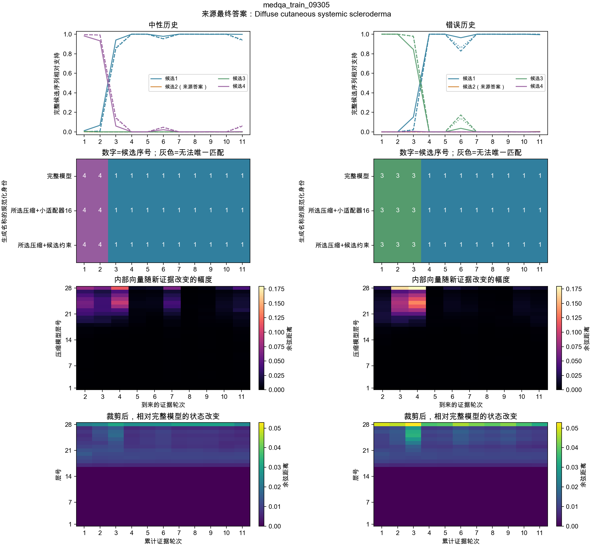

# medqa_train_09305

来源：MedQA。最终来源答案：**Diffuse cutaneous systemic scleroderma**。错误历史预设：Polymyositis。

候选：1. Limited cutaneous systemic scleroderma；2. Diffuse cutaneous systemic scleroderma；3. Polymyositis；4. SLE

实际诊断色块按统一表面写法后的候选身份绘制；逐字输出保留在下表与原文件。上图颜色按候选序号，实线=完整模型、虚线=压缩适配器、点线=第三个冻结方法。序列支持是四个完整字符串归一化后的模型分数，不是临床概率；遇到候选约束模型，则为受约束分布。内部距离只量化表示变化幅度，不能单独说明正朝哪个疾病变化；疾病方向以实际生成和完整候选支持观察。

| 轮次 | 新增事实（保留来源原文） |
|---|---|
| 1 | A 35-year-old woman comes to the clinic with complaints of joint pain and stiffness for the past few months. |
| 2 | Her hands, lower back, and left knee are involved and associated with morning stiffness that improves throughout the day with activities. |
| 3 | She also complains that her fingers change color upon exposure to cold. |
| 4 | She has also noticed a tightening of the skin on her face and thinning of her lips. |
| 5 | She feels tired throughout the day and has taken over-the-counter multivitamins that do not seem to help her much. |
| 6 | The patient does not smoke cigarettes and drinks alcohol socially. |
| 7 | She was diagnosed with hypertension 1 year ago and has been taking hydralazine for the past year. |
| 8 | She lost her parents in a road traffic accident 3 years ago. |
| 9 | Temperature is 36.7°C (98°F), blood pressure is 140/85 mm Hg, pulse is 72/min, respirations are 12/min, and BMI is 25 kg/m2. |
| 10 | Her skin appears shiny and slightly thickened, especially her face and hands. |
| 11 | Laboratory investigation: Complete blood count Hemoglobin 9.5 g/dl Leucocytes 5,500/mm3 Platelets 150,000/mm3 ANA positive Anti-centromere Antibody negative Anti Scl-70 positive Anti Jo-1 negative Anti-histone negative Anti DsDNA negative |

## 中性历史

| 轮次 | 方法 | 实际诊断 | 最终来源答案支持 | 错误历史诊断支持 |
|---|---|---|---:|---:|
| 1 | 完整模型 | SLE | 0.001 | 0.005 |
| 1 | 所选压缩+小适配器16 | SLE | 0.001 | 0.002 |
| 1 | 所选压缩+候选约束 | SLE | 0.001 | 0.002 |
| 2 | 完整模型 | SLE | 0.000 | 0.000 |
| 2 | 所选压缩+小适配器16 | SLE | 0.000 | 0.000 |
| 2 | 所选压缩+候选约束 | SLE | 0.000 | 0.000 |
| 3 | 完整模型 | Limited cutaneous systemic scleroderma | 0.000 | 0.000 |
| 3 | 所选压缩+小适配器16 | Limited cutaneous systemic scleroderma | 0.000 | 0.000 |
| 3 | 所选压缩+候选约束 | Limited cutaneous systemic scleroderma | 0.000 | 0.000 |
| 4 | 完整模型 | Limited cutaneous systemic scleroderma | 0.000 | 0.000 |
| 4 | 所选压缩+小适配器16 | Limited cutaneous systemic scleroderma | 0.000 | 0.000 |
| 4 | 所选压缩+候选约束 | Limited cutaneous systemic scleroderma | 0.000 | 0.000 |
| 5 | 完整模型 | Limited cutaneous systemic scleroderma | 0.000 | 0.000 |
| 5 | 所选压缩+小适配器16 | Limited cutaneous systemic scleroderma | 0.000 | 0.000 |
| 5 | 所选压缩+候选约束 | Limited cutaneous systemic scleroderma | 0.000 | 0.000 |
| 6 | 完整模型 | Limited cutaneous systemic scleroderma | 0.000 | 0.000 |
| 6 | 所选压缩+小适配器16 | Limited cutaneous systemic scleroderma | 0.000 | 0.000 |
| 6 | 所选压缩+候选约束 | Limited cutaneous systemic scleroderma | 0.000 | 0.000 |
| 7 | 完整模型 | Limited cutaneous systemic scleroderma | 0.000 | 0.000 |
| 7 | 所选压缩+小适配器16 | Limited cutaneous systemic scleroderma | 0.000 | 0.000 |
| 7 | 所选压缩+候选约束 | Limited cutaneous systemic scleroderma | 0.000 | 0.000 |
| 8 | 完整模型 | Limited cutaneous systemic scleroderma | 0.000 | 0.000 |
| 8 | 所选压缩+小适配器16 | Limited cutaneous systemic scleroderma | 0.000 | 0.000 |
| 8 | 所选压缩+候选约束 | Limited cutaneous systemic scleroderma | 0.000 | 0.000 |
| 9 | 完整模型 | Limited cutaneous systemic scleroderma | 0.000 | 0.000 |
| 9 | 所选压缩+小适配器16 | Limited cutaneous systemic scleroderma | 0.000 | 0.000 |
| 9 | 所选压缩+候选约束 | Limited cutaneous systemic scleroderma | 0.000 | 0.000 |
| 10 | 完整模型 | Limited cutaneous systemic scleroderma | 0.000 | 0.000 |
| 10 | 所选压缩+小适配器16 | Limited cutaneous systemic scleroderma | 0.000 | 0.000 |
| 10 | 所选压缩+候选约束 | Limited cutaneous systemic scleroderma | 0.000 | 0.000 |
| 11 | 完整模型 | Limited cutaneous systemic scleroderma | 0.000 | 0.000 |
| 11 | 所选压缩+小适配器16 | Limited cutaneous systemic scleroderma | 0.000 | 0.000 |
| 11 | 所选压缩+候选约束 | Limited cutaneous systemic scleroderma | 0.000 | 0.000 |

## 错误历史

| 轮次 | 方法 | 实际诊断 | 最终来源答案支持 | 错误历史诊断支持 |
|---|---|---|---:|---:|
| 1 | 完整模型 | Polymyositis | 0.000 | 1.000 |
| 1 | 所选压缩+小适配器16 | Polymyositis | 0.000 | 1.000 |
| 1 | 所选压缩+候选约束 | Polymyositis | 0.000 | 1.000 |
| 2 | 完整模型 | Polymyositis | 0.000 | 1.000 |
| 2 | 所选压缩+小适配器16 | Polymyositis | 0.000 | 1.000 |
| 2 | 所选压缩+候选约束 | Polymyositis | 0.000 | 1.000 |
| 3 | 完整模型 | Polymyositis | 0.000 | 0.844 |
| 3 | 所选压缩+小适配器16 | Polymyositis | 0.000 | 0.979 |
| 3 | 所选压缩+候选约束 | Polymyositis | 0.000 | 0.977 |
| 4 | 完整模型 | Limited cutaneous systemic scleroderma | 0.000 | 0.000 |
| 4 | 所选压缩+小适配器16 | Limited cutaneous systemic scleroderma | 0.000 | 0.000 |
| 4 | 所选压缩+候选约束 | Limited cutaneous systemic scleroderma | 0.000 | 0.000 |
| 5 | 完整模型 | Limited cutaneous systemic scleroderma | 0.000 | 0.000 |
| 5 | 所选压缩+小适配器16 | Limited cutaneous systemic scleroderma | 0.000 | 0.000 |
| 5 | 所选压缩+候选约束 | Limited cutaneous systemic scleroderma | 0.000 | 0.000 |
| 6 | 完整模型 | Limited cutaneous systemic scleroderma | 0.000 | 0.036 |
| 6 | 所选压缩+小适配器16 | Limited cutaneous systemic scleroderma | 0.000 | 0.174 |
| 6 | 所选压缩+候选约束 | Limited cutaneous systemic scleroderma | 0.000 | 0.140 |
| 7 | 完整模型 | Limited cutaneous systemic scleroderma | 0.000 | 0.001 |
| 7 | 所选压缩+小适配器16 | Limited cutaneous systemic scleroderma | 0.000 | 0.000 |
| 7 | 所选压缩+候选约束 | Limited cutaneous systemic scleroderma | 0.000 | 0.000 |
| 8 | 完整模型 | Limited cutaneous systemic scleroderma | 0.000 | 0.000 |
| 8 | 所选压缩+小适配器16 | Limited cutaneous systemic scleroderma | 0.000 | 0.000 |
| 8 | 所选压缩+候选约束 | Limited cutaneous systemic scleroderma | 0.000 | 0.000 |
| 9 | 完整模型 | Limited cutaneous systemic scleroderma | 0.000 | 0.002 |
| 9 | 所选压缩+小适配器16 | Limited cutaneous systemic scleroderma | 0.000 | 0.000 |
| 9 | 所选压缩+候选约束 | Limited cutaneous systemic scleroderma | 0.000 | 0.000 |
| 10 | 完整模型 | Limited cutaneous systemic scleroderma | 0.000 | 0.000 |
| 10 | 所选压缩+小适配器16 | Limited cutaneous systemic scleroderma | 0.000 | 0.000 |
| 10 | 所选压缩+候选约束 | Limited cutaneous systemic scleroderma | 0.000 | 0.000 |
| 11 | 完整模型 | Limited cutaneous systemic scleroderma | 0.003 | 0.002 |
| 11 | 所选压缩+小适配器16 | Limited cutaneous systemic scleroderma | 0.001 | 0.000 |
| 11 | 所选压缩+候选约束 | Limited cutaneous systemic scleroderma | 0.001 | 0.000 |

原始逐轮生成、各层2048维状态和适配器前后向量见[runs轨迹目录](../../../runs/structural_v2/trajectories)。中间前缀没有独立诊断真值；“匹配来源答案”只描述是否提前到达最终答案。
